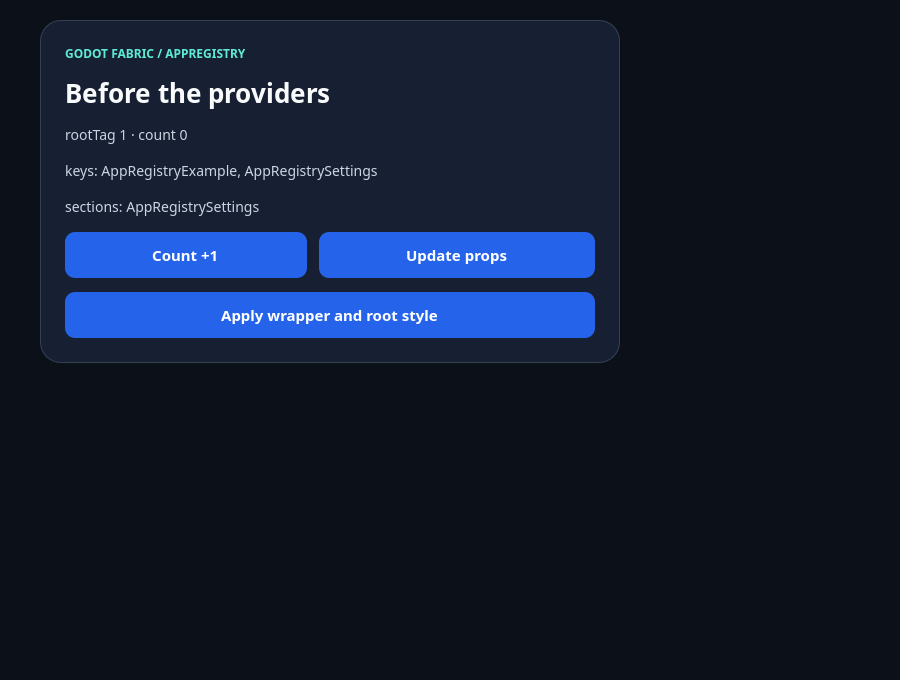
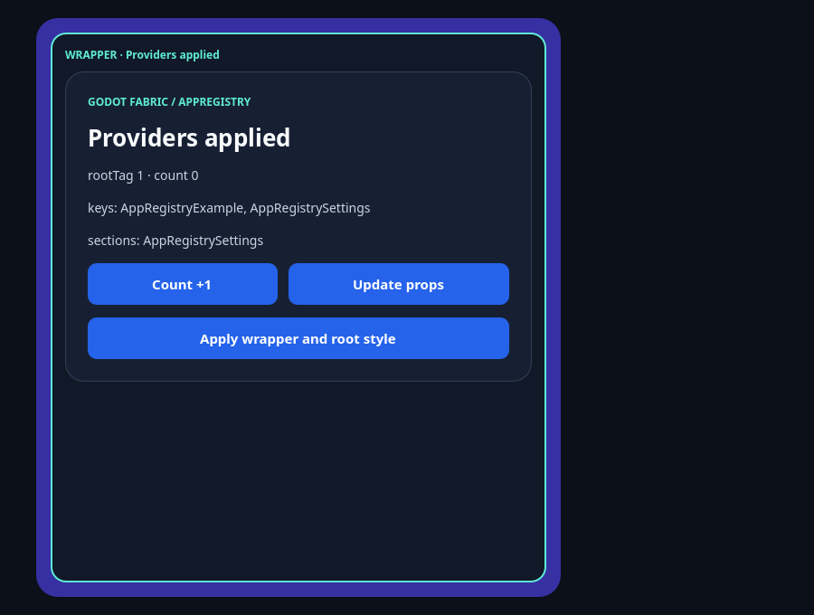

# AppRegistry: os 19 membros do RN 0.87.1 sobre o host Godot

GF-07, fatia 1 (a fachada do AppRegistry). A decisão de 2026-10-13 é paridade com o RN: a fachada pública expõe todo
membro do `AppRegistry` do RN 0.87.1 que tem significado no Godot, cada um testado, e o membro sem significado no host
(as tarefas headless) vira um erro tipado e documentado, nunca um no-op silencioso e nunca uma propriedade ausente. A
fachada (`src/app-registry.js`) delega ao `AppRegistryImpl` original do RN onde o comportamento do RN se aplica e não o
reimplementa; o que ela acrescenta cabe em três regras: a V2-D01 (uma chave registrada uma vez nunca é substituída, por
qualquer rota), o erro tipado das tarefas headless e a recusa de uma `rootTag` que nenhuma Surface do host possui.

Esta fatia não muda código nativo: o host é o de `main` (`68bee92`, SHA-256 `290c4a77…3542`). A sonda roda o host real,
sem janela (`--headless`), e o controle causal é um conjunto de nove sabotagens retidas do SDK em lugar de um host
anterior. Esta fatia não fecha checkpoint nenhum. O commit de implementação é `baa1c4cf`, o `implementationCommit` de
[report.json](report.json). A execução hospedada no CI, a de número 38473856206, rodou sobre a cabeça `9cdae802` (que não é
o commit de implementação) e passou em todos os jobs: o `native-suites-frontier` passou na repetição, depois do flake
conhecido do `cpu-time-instrument`, que o PR #162 corrige à parte.

## Os membros

Cada linha cita o código do RN (`node_modules/react-native/Libraries/ReactNative/AppRegistryImpl.js`, que a fachada
importa) e o que o host faz. A coluna da fachada cita `src/app-registry.js`, o host `native/application_runtime.cpp` e o
container `src/render-application.jsx`.

| Membro | Estado | RN (`AppRegistryImpl.js`) | No Godot |
| --- | --- | --- | --- |
| `registerComponent(key, provider, section?)` | exposto | 92-120: grava o runnable, e em `sections` se `section` for verdadeiro | RN, com a V2-D01 (fachada 79-85): chave vazia ou não string e provider que não é função dão `TypeError`; chave já registrada ou reservada (`__proto__`, `constructor`, `prototype`) dá `Error`. O parâmetro `section` deixou de ser recusado: o registro de seções é só do JS e a montagem usa `getAppKeys` (host 778-789), então uma seção monta como qualquer componente |
| `registerSection(key, provider)` | exposto | 133-138: `registerComponent(key, provider, true)` | RN, com as mesmas recusas (fachada 93-99) |
| `registerRunnable(key, run)` | exposto | 125-128: grava `run` | RN, com as mesmas recusas (fachada 86-92); o host chama o runnable com `{rootTag, initialProps, fabric: true}` e o display mode 1 |
| `registerConfig(configs)` | exposto | 65-83: `run` vence, depois `component`, e nenhum dos dois é um invariant do RN | RN (fachada 60-78). Antes de delegar, a fachada recusa uma lista que não é lista, uma entrada malformada e uma chave repetida (inclusive duas vezes na mesma lista), sem registrar nada; o invariant do RN continua julgando a entrada sem `run` nem `component`, depois das entradas anteriores |
| `getAppKeys()` | exposto | 143-145 | RN (fachada 100). Não há `LogBox`: a fachada importa `AppRegistryImpl`, não `AppRegistry.js`, que registra o `LogBox` (15-23) |
| `getSectionKeys()` | exposto | 150-152 | RN (fachada 101) |
| `getSections()` | exposto | 157-161: cópia do mapa | RN (fachada 102) |
| `getRunnable(key)` | exposto | 166-168: lê um objeto simples | RN, mas responde `undefined` a um nome que ninguém registrou (fachada 104-106): o objeto simples do RN responderia a função de `Object.prototype` para `toString` |
| `getRegistry()` | exposto | 173-178: `sections` e uma cópia dos runnables | RN (fachada 107) |
| `setWrapperComponentProvider(provider)` | exposto | 47-51; usado em 106-108 a cada execução do runnable | RN (fachada 58). O componente do wrapper envolve o conteúdo da raiz com as `initialProps` dela (`render-application.jsx` 25-27) |
| `setRootViewStyleProvider(provider)` | exposto | 57-59; usado em 109-110 | RN (fachada 59). O estilo substitui o `{flex: 1}` padrão, como o `AppContainer-prod.js` 37 do RN, e chega ao Control nativo da raiz (`render-application.jsx` 30) |
| `setComponentProviderInstrumentationHook(hook)` | exposto | 184-188; usado em 100-103: recebe o provider e o logger de performance (stub deprecado) | RN (fachada 108) |
| `runApplication(key, appParameters, displayMode?)` | exposto | 197-216: loga, exige o runnable e o executa | RN, só para uma Surface que a cena montou (fachada 109-112): `appParameters.rootTag` é a tag dela e a raiz renderiza de novo com as novas `initialProps`; o componente mantém o estado enquanto a árvore acima dele mantém a forma, e a primeira execução depois de um wrapper ou de um hook coloca um elemento novo acima dele, o que o monta de novo, como no RN. Uma tag que nenhuma Surface em execução possui dá `E_APP_REGISTRY_UNKNOWN_ROOT`: o Godot cria a Surface pela cena (`FabricSurface.mount()`), não pelo JS. O host chama o `AppRegistry` do RN direto, sem passar pela fachada (host 744) |
| `setSurfaceProps(key, appParameters, displayMode?)` | exposto | 221-243 | Idem (fachada 113-116); o caminho do host (`FabricSurface.update_props`, host 865) segue pelo binding do RN. Um display mode que não é visível continua recusado por `render-application.jsx` 22-23, até a fatia de pausa e retomada |
| `unmountApplicationComponentAtRootTag(rootTag)` | exposto | 251-255: só `console.error` | RN (fachada 118): loga o erro do RN e não desmonta nada; a raiz sai por `FabricSurface.unmount()` (host 1371 chama `RN$stopSurface`) |
| `registerHeadlessTask(taskKey, taskProvider)` | erro tipado | 263-271 | `E_APP_REGISTRY_HEADLESS_TASK` (fachada 41-46, 119) |
| `registerCancellableHeadlessTask(taskKey, taskProvider, taskCancelProvider)` | erro tipado | 280-292 | `E_APP_REGISTRY_HEADLESS_TASK` (fachada 120) |
| `startHeadlessTask(taskId, taskKey, data)` | erro tipado | 300-339 | `E_APP_REGISTRY_HEADLESS_TASK` (fachada 121) |
| `cancelHeadlessTask(taskId, taskKey)` | erro tipado | 347-353 | `E_APP_REGISTRY_HEADLESS_TASK` (fachada 122) |

Uma tarefa headless é um serviço Android (`HeadlessJsTaskService`, `NativeHeadlessJsTaskSupport` só existe no
ReactAndroid) que roda JS sem UI; o Godot não tem serviço de fundo para iniciá-la. O mapa de contratos já marcava os
quatro membros como `not-applicable` no Godot, e esta fatia não muda o motivo deles. O erro tipado é o resultado deles no
Godot, e `E_APP_REGISTRY_HEADLESS_TASK` é a fixture negativa que o catálogo de fixtures do GF-01 (S3) vai referenciar. Nada é
registrado nem iniciado.

Os erros seguem a convenção `E_*` do SDK (`src/godot-fabric.js`, `failure`): o código abre a mensagem
(`<código>: <o quê e por quê>`) e também é `error.code`. [docs/API.md](../../API.md#appregistry-members) lista os dois:

| Código | Quando |
| --- | --- |
| `E_APP_REGISTRY_HEADLESS_TASK` | qualquer um dos quatro membros headless é chamado |
| `E_APP_REGISTRY_UNKNOWN_ROOT` | `runApplication` ou `setSurfaceProps` nomeia uma `rootTag` que nenhuma Surface em execução possui |

O container (`render-application.jsx` 8-14 e 39) guarda as tags que renderizou, e `RN$stopSurface`, que o host chama ao
parar a raiz (`app-registry.js` 12-18), esquece a tag: depois de parada, a tag deixa de ser uma Surface. As tags do host
nunca se repetem na mesma aplicação (`next_surface_id += 10`).

## A sonda nativa

`tests/app-registry-fixture.jsx` roda, ao carregar o bundle, um roteiro de 39 operações (28 chamadas que registram,
recusam ou falham, entre elas os 7 registros, as 6 recusas de chave repetida, as 4 de chave reservada, as 7 entradas
inválidas e os 4 membros headless, e 11 leituras do registro; são linhas de dados, não código, e o oráculo repete as
mesmas linhas) e registra o resultado de cada uma; `tests/app-registry-probe.gd` monta seis
`FabricSurface` reais de uma `FabricApplication` e exercita os membros de superfície pelo JS e pelo Godot.
`tests/app-registry-native.test.mjs` (`npm run test:app-registry`) empacota o fixture (o bundle roda
`AppRegistryImpl.js`, `RootTag.js`, `DisplayMode.js`, o stub do logger e o `ReactFabric-prod.js` originais), roda o Godot
sem janela, guarda relatório e log e confere o relatório com o oráculo.

**41 checagens**, nomeadas `<caso>/<frase>` no relatório, todas passam:

- `facade` (2): a fachada é congelada e expõe exatamente os 19 membros do RN como funções; o registro nasce vazio.
- `registry` (8): os retornos de cada rota de registro; `getAppKeys` em ordem de registro, com a primeira entrada da config
  que falha; o invariant do RN para a entrada sem `run` nem `component`, depois da anterior; as seções (rota de seção, flag
  verdadeiro e config; o flag falso não é seção); `getSections` e `getRegistry` com as mesmas funções que `getRunnable`
  responde; `getRunnable` de chave desconhecida e de nome herdado; as respostas são cópias.
- `diagnostics` (4): a V2-D01 por componente, seção, runnable e config, e duas vezes na mesma config; as três chaves
  reservadas por todas as rotas; chave, provider, run e config inválidos dão `TypeError`; as recusas não registram nada.
- `headless` (2): os quatro membros dão `E_APP_REGISTRY_HEADLESS_TASK` com o nome do membro; nenhum registra, inicia ou
  loga (o aviso do RN para tarefa repetida não aparece).
- `mount-A` (2): a raiz montada antes dos providers recebe as props, a `rootTag` como prop e em `RootTagContext`, e a raiz
  é a padrão do RN (preenche a Surface, sem fundo, nada envolve o conteúdo).
- `providers` (1) e `mount-B` (4): definir os providers não chama nenhum; a raiz montada depois recebe, no Control nativo,
  o fundo, o raio e o tamanho do estilo do provider; o wrapper envolve o conteúdo dentro do padding da raiz; o provider do
  wrapper recebe `appParameters` e a chave, o do estilo recebe `appParameters`, o wrapper recebe as `initialProps`; o hook
  recebe o provider e o logger do RN e o componente que ele devolve renderiza o da raiz.
- `set-props` (2), `run-application` (1) e `host-update` (1): `setSurfaceProps` atualiza as props da raiz em execução e,
  como a árvore dessa raiz (montada depois dos providers) mantém a forma, mantém o estado do componente (mesma instância,
  sem remontar, sem cleanup); o RN loga a atualização e os providers e o hook
  rodam de novo; `runApplication` numa Surface em execução faz o mesmo; `FabricSurface.update_props` chega à mesma raiz pelo
  binding do RN, com os providers aplicados.
- `rerun-A` (1): uma raiz que já rodava recebe os providers na execução seguinte (o fundo e o wrapper aparecem e o
  componente do hook remonta o conteúdo: o elemento novo acima do componente muda a forma da árvore, e o estado dele recomeça,
  como no RN; a sonda confere a remontagem pelos efeitos, e o exemplo confere o contador voltando a 0).
- `runnables` (3): um runnable de `registerRunnable` e um de `run` numa config recebem o `appParameters` e o display mode
  do host; esse runnable e uma seção montam como qualquer componente; um componente registrado depois das raízes monta.
- `unknown-root` (2) e `display-mode` (1): uma tag sem Surface dá `E_APP_REGISTRY_UNKNOWN_ROOT` e nada renderiza; uma
  chave não registrada numa Surface em execução dá o invariant do RN; um display mode suspenso continua recusado, sem
  mudar a raiz.
- `unmount-api` (1): `unmountApplicationComponentAtRootTag` loga o erro do RN e a raiz continua montada.
- `stop-A` (3) e `stop` (2): `FabricSurface.unmount` para a raiz (o cleanup do React roda uma vez e a contagem cai); a tag
  parada deixa de ser Surface; as outras raízes continuam atualizando; parar a aplicação libera tudo sem diagnóstico e os
  Controls nativos de cada raiz foram criados e apagados em número igual.
- `report` (1): o relatório é salvo com qualquer falha visível.

O **oráculo independente** (`tests/app-registry-oracle.mjs`) não divide código com o fixture, a sonda nem a fachada e julga
o relatório bruto, sem os veredictos da sonda, em seis seções: `members` (os membros da fachada são exatamente as funções
que a declaração do RN, lida do pacote instalado, exporta), `script` (cada linha do roteiro é repetida num modelo do
`AppRegistryImpl.js`, escrito a partir do código dele, com a V2-D01 acrescentada; o modelo diz o que cada chamada devolve e
como deve falhar), `mount` (a geometria e as cores dos Controls nativos seguem dos estilos que os providers devolveram),
`runs` (cada execução depois dos providers chamou cada um e o hook uma vez, o RN logou cada uma, e a tag nas props, no
`RootTagContext` e no host concorda), `surfaces` (a tag sem Surface e a de uma raiz parada não renderizam e dão o código
documentado; o membro de desmontagem loga o erro do RN e não desmonta; o erro, os logs e o invariant são lidos do próprio
`AppRegistryImpl.js`) e `stop`. Aceita as seis.

## O controle causal

Como a fatia não muda o host, o controle é um conjunto de **nove sabotagens retidas** do SDK
(`scripts/app-registry-sabotage.mjs`, com a tabela em `tests/app-registry-sabotages.mjs`, que
`tests/sabotage-anchors.test.mjs` confere): cada uma quebra uma decisão da fachada, roda a mesma sonda e o mesmo oráculo
sobre o SDK quebrado, o fonte volta byte a byte (prova por hash, inclusive com sinal) e a sonda e o oráculo precisam
rejeitar. Todas foram rejeitadas pelos dois:

| Sabotagem | O que quebra | Checagens da sonda que falham | Seções do oráculo que rejeitam |
| --- | --- | ---: | --- |
| `section-dropped` | `registerComponent` esquece o flag de seção | 3 | `script` |
| `duplicate-accepted` | uma chave registrada uma vez pode ser registrada de novo | 1 | `script` |
| `headless-silent` | os membros headless retornam em vez de falhar | 1 | `script` |
| `wrapper-ignored` | `setWrapperComponentProvider` não faz nada | 5 | `mount`, `runs` |
| `props-dropped` | `setSurfaceProps` não faz nada | 8 | `mount`, `runs`, `stop` |
| `inherited-runnable` | `getRunnable("toString")` devolve a função de `Object.prototype` | 1 | `script` |
| `root-not-tracked` | o container nunca informa as raízes que renderiza | 9 | `mount`, `runs`, `stop` |
| `stop-not-forgotten` | a parada do host não é notada: a tag parada segue sendo Surface | 1 | `surfaces` |
| `unknown-root-unchecked` | uma tag sem Surface chega ao renderer | 2 | `runs`, `surfaces` |

## Capturas

Capturas reais do renderer nativo (`npm run example -- app-registry --capture`, 20 checagens, 15 sem janela, janela aberta por alguns
segundos), do [exemplo](../../../examples/app-registry/README.md): a mesma Surface antes e depois de o botão definir os
providers e rodar a raiz de novo com `setSurfaceProps`. A validação do exemplo conta o cartão antes (contador 1), aplica o
wrapper (o cartão monta de novo e o contador volta a 0), conta de novo (2) e atualiza as props (o contador continua em 2).
Os SHA-256 estão em [report.json](report.json).

**Antes**: a raiz padrão do RN. A View raiz preenche a Surface, não tem fundo, e nada envolve o cartão; o título é
`Before the providers`, `getAppKeys` lista `AppRegistryExample, AppRegistrySettings` e `getSectionKeys` lista a seção.

**Com os providers**: a raiz é a View índigo de cantos arredondados que o provider de estilo devolveu, com padding de 16
pontos, e a moldura que o provider do wrapper devolveu envolve o cartão e mostra as `initialProps` da raiz
(`WRAPPER · Providers applied`). Os Controls da raiz e do wrapper foram lidos do host (fundo `3730a3ff`, raio 24,
wrapper em 16,16) antes da captura.

## Regressões

- `npm run test:application`: 4/4 (a suíte das raízes compartilhadas, 35 checagens; a falha de ativação, 19, ainda confere
  que uma chave duplicada por seção é recusada, agora por `registerSection("HUD", …)`; o exemplo `shared` trocou o registro de
  seção, que a fachada antes recusava, pela duplicata por seção).
- `npm run test:responders:shared-touches`: 1/1 com as raízes compartilhadas e o toque. A primeira execução reprovou só a
  comparação final com `build/shared-touches-original-report.json`, um controle do host anterior gravado em 2026-10-05 com
  outro bundle do SDK; com esse arquivo posto de lado (e devolvido byte a byte) a suíte passa.
- `npm run test:app-state` e `npm run test:scope-0.5` (que usa o `AppRegistry` público): passam.
- `npm run type-check` (com `tests/types/consumer.tsx`, que passa a usar os 19 membros e recusar chave, provider, flag de
  seção, `rootTag` e config errados), `npm run check:static`, `npm run check:publication`, `npm run test:dashboard` e
  `node scripts/milestone-guards.mjs --check --base origin/main`: passam. `npm run test:contracts`: 776 testes de Node (775
  passam e 1 é pulado, o do template de exportação do macOS, sem `MACOS_EXPORT_TEMPLATE`) e 37 de Python, nenhuma falha.

## Mapa de contratos e auditoria

O mapa (`docs/compatibility/contract-map-0.87.1.json`) já dava aos 19 membros o dono GF-07, escopo `1_0` e `applies` no
Godot, exceto os quatro headless (`not-applicable`, com motivo): bate com os achados, e esta fatia não altera o mapa. O
motivo dos quatro não muda: a referência a uma fixture pertence ao catálogo de fixtures do GF-01 (S3), que vai referenciar
`E_APP_REGISTRY_HEADLESS_TASK` como a fixture negativa deles. `unmountApplicationComponentAtRootTag` segue `applies`: o
membro existe e faz o que o RN faz (loga um erro); a desmontagem em si é do host nas três plataformas, o que o mapa não
separa.

A auditoria de 2026-10-01 (`docs/compatibility/react-native-0.87.1.json`) marcava `AppRegistry` e `RootTagContext` como
`missing_public_export`, e estava velha: a fachada exporta os dois desde a fatia das raízes compartilhadas. As duas linhas
agora são `environment_or_utility_subset`, com evidência e nota; com elas a tabela de [docs/PARITY.md](../../PARITY.md) passa
a 23 nomes de ambiente e 55 ausentes, e o manifesto do 0.5 (`docs/compatibility/scope-0.5.json`) copia a linha nova e deixa de
marcar o `AppRegistry` como velho. O subconjunto do 0.5 continua sendo `registerComponent` e `getAppKeys`, que o HUD usa e o
scan da HUD confere; os outros membros existem na fachada, mas continuam fora dele.

## Limites e o que muda nas próximas fatias do GF-07

Não certificado por esta fatia: troca de raiz repetida com timers e RAF dos componentes, pausa e retomada, mudança de cena,
limpeza por erro (V2-D26), display modes suspenso e oculto (continuam recusados por `render-application.jsx`, e o check
`display-mode/…` da sonda deve mudar com a fatia de pausa e retomada) e overlays e portais. A
fatia de limpeza por erro que tira uma raiz do ar deve chamar `forgetSurface` (`render-application.jsx` 12-14) para que a
tag dela deixe de ser Surface; a de troca de raiz não precisa de mudança, porque as tags nunca se repetem. Os providers são
estado do módulo do `AppRegistryImpl`, portanto de cada `FabricApplication` (um runtime Hermes); a fatia de troca de cena que
reusa a aplicação herda isso.
