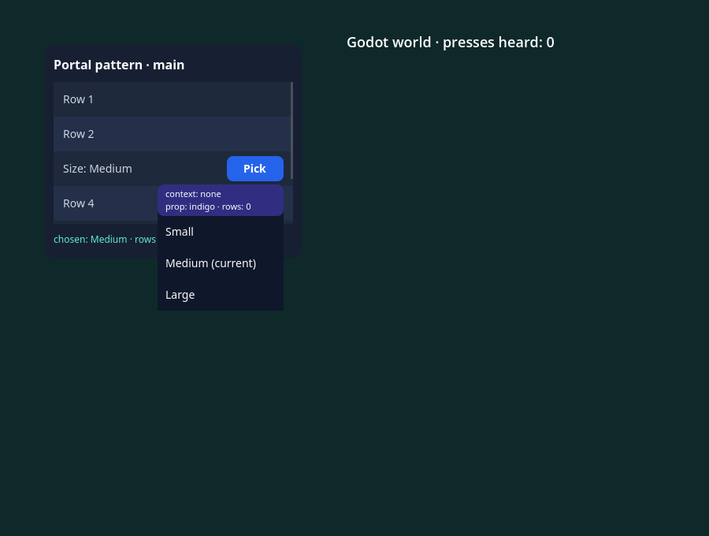
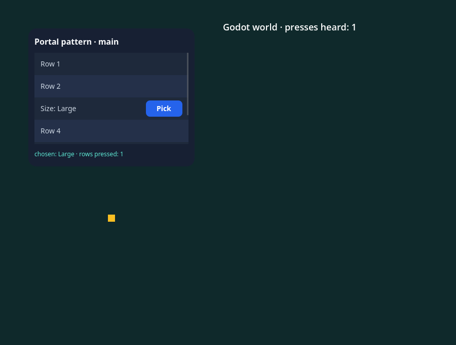

# Padrão de portal dentro da raiz: um overlay que não bloqueia, certificado no host Godot

GF-07, fatia de overlays. A decisão de 2026-10-14 ([nota de desenho](../../research/overlays-portals.md)) é paridade com o RN
como contrato (`zIndex` e Views absolutas numa raiz, `Modal` para o GF-18 e uma segunda `FabricSurface`) mais a opção (c): o padrão
de uma View host dentro da raiz, alimentada por Context e instalada por `AppRegistry.setWrapperComponentProvider`, documentado e
certificado por uma fixture. **Não há `createPortal` no SDK** e esta fatia não acrescenta nenhum auxiliar: o padrão vive no
[exemplo](../../../examples/portal-pattern/README.md) (`examples/portal-pattern/App.jsx`) e em [docs/API.md](../../API.md#overlays-and-portals).
Se o par host/`Portal` também vira um auxiliar do SDK não foi decidido.

O padrão responde ao caso que a paridade com o RN deixa sem resposta: um overlay que não bloqueia (dropdown, tooltip, menu), aberto
dentro de um ancestral que recorta ou forma um contexto de empilhamento (um `ScrollView`, uma linha de lista), e que precisa aparecer
acima de tudo na raiz sem parar o jogo. Um `PortalProvider` guarda as entradas em estado e renderiza o conteúdo da raiz seguido de um
`PortalHost`, uma View absoluta de tela cheia com `pointerEvents="box-none"` e `zIndex`; um `Portal` registra os filhos no provider por
Context ao montar, atualiza ao mudar e remove ao desmontar. O provider vale por raiz, porque o AppRegistry roda o provider do wrapper
para cada raiz que executa.

Esta fatia não muda código nativo: o host é o de `main` (`4e16cf0`, SHA-256 `0c17cd4f…e160`), reconstruído nesta árvore a partir dos
tarballs em cache e confirmado por um segundo `cmake --build` que não construiu nada. **O controle do host anterior não se aplica**, pelo
mesmo motivo: não há host anterior para rodar. O controle causal é um conjunto de **cinco sabotagens retidas do exemplo**. Esta fatia
não fecha checkpoint nenhum. O `implementationCommit` de [report.json](report.json) é `PINXR` até a orquestração commitar e trocar o valor;
os SHA-256 das fontes são os dos arquivos da árvore que rodou. Não há execução hospedada ainda: a suíte está registrada no job
`native-suites-runtime` (artefato `native-portal-pattern`), que roda por `workflow_dispatch`.

## O que o padrão faz

O cenário é um cartão com um `ScrollView` de seis linhas. A terceira linha tem um botão **Pick** que mede a si mesmo com
`measureInWindow`, mede o host da mesma forma (a Surface não está na origem da janela, então os dois diferem) e abre um dropdown
por `Portal`, embaixo do botão e com a borda direita na dele. O dropdown passa da borda de baixo do `ScrollView` e do cartão. Escolher
um item fecha o dropdown e atualiza a linha. Não há fundo que feche o dropdown por um toque de fora: o host é `box-none` para que o
toque alcance o que está embaixo.

## A sonda nativa

`tests/portal-pattern-fixture.jsx` importa o próprio exemplo (que instala o provider e registra `PortalPatternExample` antes de qualquer
raiz rodar) e expõe o gancho de observação do exemplo; `tests/portal-pattern-probe.gd` monta duas `FabricSurface` reais de uma
`FabricApplication`, na frente de um nó Godot que faz o papel do mundo do jogo (ouve `_unhandled_input`, como o mundo do pico de
ponteiro), e as dirige com eventos reais de mouse (`Input.parse_input_event`). Os Controls nativos vêm da cena (pai, ordem, recorte,
filtro de mouse, retângulo global), os quadros e os textos do snapshot do host, e o que os handlers JS contaram, do gancho do
exemplo. `tests/portal-pattern-native.test.mjs` (`npm run test:portal-pattern`) empacota a fixture (o bundle roda `AppRegistryImpl.js`,
`View.js`, `ScrollView.js` e o `ReactFabric-prod.js` originais), roda o Godot sem janela, guarda relatório e log e confere o relatório
com o oráculo. Nenhuma checagem fixa contagem que dependa do ritmo do runner: as esperas são por condição (com limite de tempo, e curto depois de
uma espera que falhou), e os números conferidos são os de eventos injetados.

**23 checagens**, nomeadas `<caso>/<frase>` no relatório, todas passam:

- `placement` (5): o provider pôs um host na raiz, último filho da View da raiz, preenchendo-a e sem recortar; o Control do host e o da
  raiz ignoram o mouse (`box-none`); os Controls do dropdown são filhos do Control do host e de nada do `ScrollView` nem do cartão; o host
  e o que ele contém vêm depois de todo outro Control da raiz na ordem da árvore, então o Godot os desenha por último; o dropdown fica embaixo do
  gatilho com a borda direita na dele, na posição que o gatilho mediu com `measureInWindow`.
- `clipping` (2): o Control do `ScrollView` recorta o conteúdo; o dropdown passa do retângulo do `ScrollView` (110 pontos abaixo da borda
  de baixo) e nenhum ancestral recorta parte dele.
- `input` (6): um toque de mouse real no item o alcança (escolhe `Large`, fecha, e não chega à linha de baixo nem ao mundo); um toque numa
  linha fora do dropdown aberto alcança a linha e o dropdown continua aberto; o corpo do dropdown (o cabeçalho, sem handler) não chega à
  linha embaixo nem ao mundo (o dropdown é opaco); depois de fechado, um toque onde ele estava alcança a linha; um toque na área vazia da
  Surface atravessa o host `box-none` até o mundo, com o dropdown aberto e com ele fechado.
- `lifecycle` (5): fechado, o host não tem Controls; o conteúdo do portal atualiza enquanto aberto (o dropdown mostra a contagem de
  linhas e continua aberto); escolher fecha o dropdown e os Controls saem do host; desmontar uma raiz com o portal aberto remove o host e os
  Controls do portal sem sobra e a outra raiz mantém o seu; parar a aplicação não deixa host nem Control de portal, com os Controls criados e
  apagados em número igual e sem diagnóstico.
- `roots` (3): uma segunda raiz tem host próprio, vazio e no lugar dela, embora exista um portal na primeira; cada host contém exatamente o dropdown
  dele, que nunca aparece na outra raiz; o estado é por raiz (escolher na segunda muda só a linha dela, e o dropdown da primeira continua aberto).
- `context` (1): o Context do gatilho (`indigo`) não chega ao conteúdo do portal, que renderiza sob os providers do host e lê o padrão
  (`none`); uma prop carrega o valor. É o **limite conhecido do padrão**.
- `report` (1): o relatório é salvo com qualquer falha visível.

O **oráculo independente** (`tests/portal-pattern-oracle.mjs`) não divide código com o exemplo, a fixture nem a sonda e julga o relatório bruto
em oito seções: `report` (o relatório é o da lane genuína, de uma execução sem janela; a regra de contexto de empilhamento e a de
fatiamento do Fabric ainda estão no C++ do RN instalado), `layout` (os quadros do cenário, derivados dos números do `LAYOUT` que o
exemplo fixou e das regras do Yoga, para o lugar de cada raiz na janela: coluna que empilha, margem e padding que recuam, filho absoluto a
partir do canto do pai, `ScrollView` que recorta; e o que `measureInWindow` deu ao gatilho e ao host), `tree` (o host é o último filho
da View da raiz, os filhos dele são exatamente os Controls do portal, nenhum está sob o `ScrollView` ou o cartão, e vêm por último na
ordem da árvore, reconstruída de pai e índice), `clip` (quais Controls recortam e que nenhum ancestral corta o dropdown), `input` (cada
toque repetido num modelo das regras de ponteiro do host: a View sob o ponto é a intenção, e o que cada lado ouviu segue dela), `lifecycle`,
`roots` e `context`. Repete 12 toques e aceita as oito seções.

## O controle causal

Como a fatia não muda o host, o controle é um conjunto de **cinco sabotagens retidas** do exemplo (`scripts/portal-pattern-sabotage.mjs`, com a
tabela em `tests/portal-pattern-sabotages.mjs`, que `tests/sabotage-anchors.test.mjs` confere): cada uma quebra uma decisão do padrão em
`examples/portal-pattern/App.jsx`, roda a mesma sonda e o mesmo oráculo sobre o exemplo quebrado, o fonte volta byte a byte (prova por hash,
inclusive com sinal) e a sonda e o oráculo precisam rejeitar. Todas foram rejeitadas pelos dois:

| Sabotagem | O que quebra | Checagens da sonda que falham | Seções do oráculo que rejeitam |
| --- | --- | ---: | --- |
| `host-in-scroll` | o provider não renderiza host e o conteúdo do `ScrollView` o renderiza: o recorte do `ScrollView` corta o dropdown | 13 | `layout`, `tree`, `clip`, `input`, `lifecycle`, `roots`, `context` |
| `host-blocks-world` | o host perde o `pointerEvents="box-none"`: o Control dele para o mouse e a busca de acerto do RN o encontra, então a raiz inteira fica coberta e a área vazia não chega ao mundo | 17 | `layout`, `tree`, `clip`, `input`, `lifecycle`, `roots`, `context` |
| `provider-not-installed` | `setWrapperComponentProvider` nunca é chamado: nenhuma raiz tem host e o `Portal` não desenha nada | 20 | `layout`, `tree`, `clip`, `input`, `lifecycle`, `roots`, `context` |
| `portal-leaks` | o `Portal` não remove o conteúdo ao desmontar: o dropdown fechado continua no host | 6 | `tree`, `input`, `lifecycle`, `roots` |
| `host-flattened` | o host perde o `zIndex`: não forma contexto de empilhamento e o Fabric leva os Controls do portal para o Control da raiz | 4 | `tree` |

A última sabotagem existe por um achado desta fatia. O Fabric leva os filhos de uma View que não forma contexto de empilhamento para o contexto
mais próximo que forma (`sliceChildShadowNodeViewPairs.cpp`), e uma View posicionada com `zIndex` forma um (`ViewShadowNode.cpp`, a condição
`zIndex.has_value() && positionType != Static`). Sem `zIndex`, os Controls do dropdown eram irmãos do host no Control da raiz: ainda por
último na ordem e sem recorte, mas fora do host. O host leva `zIndex: 1000` por dois motivos: fica acima de um irmão posicionado que tenha
`zIndex` próprio e faz dos Controls do portal filhos do Control dele. A sabotagem prova que a checagem de "filhos do host" discrimina.

No `host-blocks-world` o dropdown nem chega a abrir: o host sem `box-none` cobre a raiz inteira e engole o toque no **Pick** também, o que
mostra mais, não menos, do que a perda da passagem para o mundo (a checagem da área vazia com o dropdown fechado reprova nele).

## Capturas

Capturas reais do renderer nativo (`npm run example -- portal-pattern --capture`, 18 checagens, 14 sem janela, janela aberta por alguns
segundos), do [exemplo](../../../examples/portal-pattern/README.md). A validação do exemplo abre o dropdown pelo botão **Pick**, toca numa
linha fora dele (o dropdown continua aberto e o conteúdo dele mostra `rows: 1`), toca na área vazia (o mundo ouve), escolhe `Large` e toca onde o
dropdown estava (a linha 4 ouve). Os SHA-256 estão em [report.json](report.json).

**Fechado**: o `ScrollView` de linhas; o mundo atrás da Surface (à direita) não ouviu nenhum toque.

**Aberto**: o dropdown, desenhado pelo host, passa da borda de baixo do `ScrollView` e cobre a borda do cartão, sem recorte; o cabeçalho dele
mostra o limite conhecido (`context: none`, embora o cartão forneça `indigo` ao gatilho) e a prop que carrega o valor (`prop: indigo`).

**Depois de escolher**: o dropdown fechou e a linha mostra `Size: Large`. O quadrado âmbar marca onde um toque na área vazia da Surface foi:
atravessou o host `box-none` até o mundo Godot, que o contou (`presses heard: 1`).

## Regressões

- `npm run test:app-registry` (1/1), `npm run test:application` (4/4) e `npm run test:scroll-view` (5/5): passam.
- `npm run test:contracts`: 788 testes de Node (787 passam e 1 é pulado, o do template de exportação do macOS), 99 de paridade, 44 do
  painel e 37 de Python, nenhuma falha. Rodou uma vez, antes da documentação e da entrada do painel; depois os testes que as leem foram
  repetidos (117/117, `test:parity` 99/99, `test:dashboard` 44/44).
- `npm run type-check`, `npm run check:static` (sem problemas), `npm run check:publication` (2.525 arquivos, nenhuma falha), `npm run test:dashboard` e
  `node scripts/milestone-guards.mjs --check --base origin/main` (X9 não se aplica, X10 limpo): passam.
- Catálogo de fixtures: nenhuma entrada nova em `docs/compatibility/fixture-catalog-0.87.1.json`. O padrão é um exemplo e não uma linha da API do RN, e a
  linha que a sonda toca de passagem (`AppRegistry.setWrapperComponentProvider`) já é reivindicada pelo #168 com as checagens do
  `test:app-registry`; não é reivindicada duas vezes.

## Limites e o que muda na próxima fatia do GF-07

- O padrão vale dentro de **uma raiz e uma Surface**: um overlay compartilhado por várias Surfaces precisa de uma segunda Surface ou de um host por raiz,
  e o host não desenha fora do retângulo da Surface.
- O Context do gatilho não chega ao conteúdo do portal (certificado como o limite conhecido); os eventos borbulham pela subárvore do host, e
  a suíte não afirma o borbulhamento.
- Não há fechamento por toque de fora: um fundo transparente de tela cheia fecharia o dropdown e bloquearia tudo embaixo, que é um overlay
  que bloqueia, e o `Modal` é o suportado.
- Só mouse: toque na tela, gamepad e foco de teclado não são exercitados.
- **Para a fatia de entrada por ordem de desenho (V2-D10)**: esta suíte mede uma Surface por vez diante do mundo e duas Surfaces lado a lado, nunca
  sobrepostas. O que ela mede e a fatia seguinte herda: a Surface não tira o ponteiro do GUI (`mouse_filter` IGNORE), o Control do host e o da raiz
  (`box-none`) também ignoram o mouse e a busca de acerto do RN não acha View alguma na área vazia, então a Surface não reivindica o toque e o mundo o
  ouve (`FabricSurface._unhandled_input` roda antes do mundo porque a Surface vem depois dele na árvore); e o host de cada Surface é uma View com
  `zIndex` **dentro** da Surface, sem relação com o `z_index` do Godot (todo Control montado leva `z_index = 0`). O que fica por ler, não medido: pela
  leitura de `pointer_hit_surface`, só concorre uma Surface em que `hit_test` acha uma View no ponto, então uma Surface de cima que use este padrão
  não deveria interceptar a área vazia dela; a fatia seguinte precisa certificar isso com Surfaces sobrepostas. A classe `World` da sonda
  (um nó que registra os toques esquerdos de `_unhandled_input`) e o auxiliar `press` servem de base.
- Hospedado: a suíte está no `native-suites-runtime` e ainda não rodou no CI.
