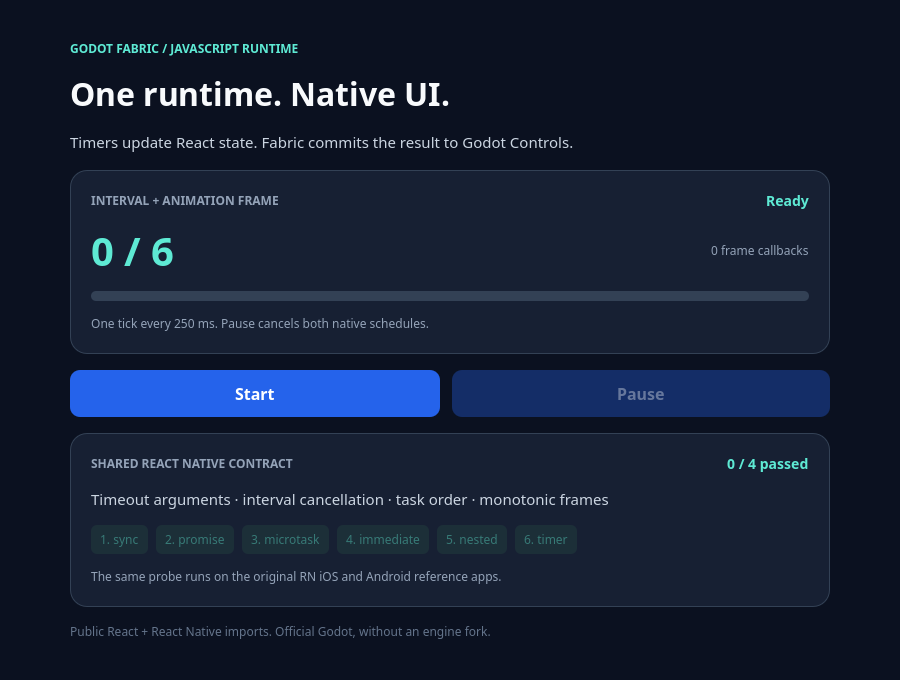
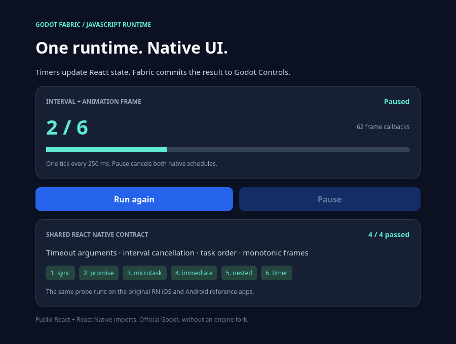
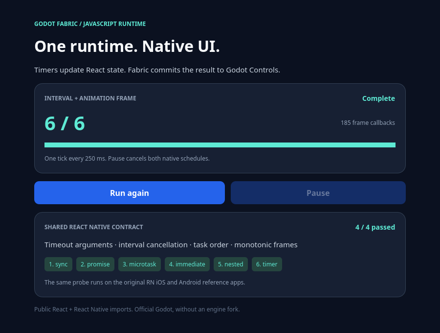

# GF-05: timers, microtasks and native frames

Local validation used macOS arm64, official Godot 4.7.2, React 19.2.3,
RN 0.87.1 and Hermes 250829098.0.17. No Godot engine rebuild was required.
This is a bounded GF-05 implementation; the roadmap item remains In progress.
The counts, hashes and captures below describe this implementation's recorded
snapshot before integration with the public form. The current catalog contains
both examples; [public control evidence](../public-controls/README.md) retains
its separate snapshot.

## What changed

The previous host had no `setInterval` or `queueMicrotask`, dropped extra
`setTimeout` arguments and implemented immediate callbacks as zero-delay timers.
A real-Hermes baseline produced `promise,timer,immediate` and an empty callback
argument list. After this change it produces `promise,immediate,timer` and
preserves `['token', 42]`.

The build compiles upstream RN `TimerManager.cpp` unchanged. It owns callback
arguments, timeout coercion and timer/interval cancellation. The Godot
[deadline registry](../../../native/timer_registry.h) implements the original
`PlatformTimerRegistry` boundary. Original RN portable microtask/immediate
modules execute over Hermes Promise jobs. Fabric's renderer and scheduler
remain upstream; this change adds no separate React reconciler.

## Runnable case and actual captures

```sh
npm run example -- runtime               # interactive native UI
npm run example -- runtime --headless    # 23 contract assertions
npm run example -- runtime --capture     # 33 assertions and renderer readbacks
npm run test:runtime                     # registry and callback-error tests
```

The [React application](../../../examples/runtime/App.jsx) only imports public
React/RN UI primitives and the shared portable runtime probe. Public Pressable
input starts and pauses a 250 ms interval and a recursive RAF loop. These
callbacks update React state; Fabric reconciles it into existing native Controls.
No native signal or direct React setter substitutes for pointer input in either
validation lane. Injected viewport events use device 1001 for OS focus isolation.

**Initial:** no interval or frame loop has started. The initial public Text
shows `0 / 6` and the progress track contains no filled pixels.



**Paused:** pointer input starts the clocks and completes four runtime probes,
then pauses at partial progress. The interval and next RAF are cancelled;
ticks and frames remain unchanged beyond the previous timer deadline. The
original Pressability delayed press-out timer is allowed to finish before
asserting the entire native timer queue is empty. Text keeps its native identity.



**Complete:** running again reaches six ticks, fills the track and cancels the
next scheduled tick/frame. The task trace below the clock shows the verified
order: sync → promise → microtask → immediate → nested microtask → timer.



These PNGs are 900 × 680 Godot Viewport readbacks. The harness asserts actual
glyph pixels, different Text-region hashes and progress pixels matching the
committed tick fraction. They are not generated illustrations or screenshots
of unrelated applications. Frame counts are observations of each run, not
cross-platform performance guarantees.

## Acceptance and original-native oracle

- **Runtime example:** 23 headless + 33 graphical assertions. Shutdown begins
  with active timers, frames, an immediate and a microtask; none execute after
  stop begins. Cached scheduling functions cannot restart work. Controls/tags,
  timers/frames/work are empty and React cleanup completes.
- **Deadline registry:** 12 native assertions cover deadline order, no early or
  duplicate dispatch, queued cancellation, zero intervals, no catch-up bursts,
  the 256-item dispatch budget and shutdown.
- **Callback failures:** six assertions in actual Hermes. Timeout, microtask,
  RAF and two recurring callback errors remain visible in the host error
  channel. Unrelated tasks still run; an interval survives an exception and
  cancels itself on its second invocation. Failed registrations and native
  work are empty after cleanup. Expected failures run separately from the
  ordinary examples; positive runs still reject every host error.
- **Regression:** all ten interactive examples passed sequentially in both
  lanes: **408 headless + 455 graphical assertions**. Two disposable projects
  passed cold import, runtime and warm import. Source gates passed 21 Node
  tests, eight Python fixtures, static analysis and the publication scan.

> Later note: since commit [`e67f82c`](https://github.com/journey-studios/godot-fabric/commit/e67f82ca54a83c8cfbc7db6e97ae11a70871ea2d) RAF callbacks run on the ticks of the
> [frame clock](../frame-clock/README.md) and not on every Godot process frame, so the
> statements here and under Remaining GF-05 work about real Godot process frames describe
> this record's executed state. The `runtime_errors` check `A failed callback cannot
> prevent unrelated queued work` no longer asserts the exact order
> `["after-frame","timeout","after-timeout"]`: timers run on every Godot frame and frame
> callbacks only on ticks, so which of them runs first is the host's pacing. It asserts that
> all three callbacks ran and that the two timers kept their order; the check name and the
> six callback-failure assertions above are unchanged.

[matrix.json](matrix.json) records fresh per-case counts/report hashes;
[provenance.json](provenance.json) binds source, upstream modules and captures.
Raw reports and logs stay in ignored `build/` and hosted artifacts.

The first hosted source gate caught output URLs in the native test being
interpreted as imports by static analysis. Existing local output files and
incremental analysis state masked the failure. The test now builds filesystem
output paths with `path.join`; `npm run check:static -- --no-cache` was verified
with both generated files absent, without adding an ignore or weakening the gate.

The first hosted iOS execution passed all 13 cases, then its simulator shutdown
exceeded the previous 30-second deadline. The runner now allows two minutes for
that owned-simulator cleanup. Timeout/errors still invalidate the report and
fail the job; a passing fixture alone does not establish a green hosted run.

The shared `core-ui-v2` oracle now has **13 cases**: the original nine UI cases
plus timeout arguments/coercion/cancellation, interval arguments/self-cancellation,
microtask/immediate ordering and cancellable monotonic frames. The same
[runtime probe](../../../tests/parity/runtime.js) is copied verbatim into the
original RN iOS and Android reference applications. Its source has its own
provenance hash; stale nine-case reports are rejected. The Godot oracle passed
locally. The [hosted run](https://github.com/journey-studios/godot-fabric/actions/runs/37006291589)
passed all five jobs on `d4e5673`, including the original iOS/Android references
and the three-way comparison. Downloaded artifacts were accepted by the current
strict protocol: **13 matched subset cases** with both mobile references.
The matrix retains that run/commit and comparison hash. This result certifies
the recorded subset; full RN API
coverage and Godot mobile builds remain separate milestones. See the
[oracle instructions](../../compatibility/BASELINE.md).

## Remaining GF-05 work

The full upstream `InitializeCore` is not installed. Idle callbacks, required
URL/encoding/abort globals, unhandled rejection/error-handler parity and
microtask starvation protection remain open. The bounded native work pump
does not bound an infinite chain of Promise jobs or arbitrary blocking JS.

> Later note: since the [networking record](../networking/README.md), RN's own `URL`,
> `URLSearchParams`, `AbortController` and `AbortSignal` (with the rest of `setUpXHR`'s
> globals) are installed by `src/initialize.js`. Their contract is certified only as far as
> that record's checks (an `AbortController` aborts its signal once, `URLSearchParams`
> decodes, `fetch` honors a signal); the encoding globals are still open, and this
> record's executed files stay as written.
>
> Later note: since the [JS globals slice](#js-globals-slice-b-2026-10-13), RN's own `window`, `self`,
> `process`, `navigator`, DOM globals, `performance` fallback and `console` polyfill run in the
> bundle; the idle callbacks, the encoding globals and the unhandled-error path stay open.
>
> Later note: since the [error path slice](#error-path-slice-c-2026-10-13), RN's own `ErrorUtils`
> and `setUpErrorHandling` run and the host answers them with RN's `JsErrorHandler` and an
> `ExceptionsManager` module, so the error-handler path is no longer open; callback exceptions
> of the timers, immediates and microtasks are slice F's.
>
> Later note: since the [React microtask path slice](#react-microtask-path-slice-d1-2026-10-13), `queueMicrotask`
> is the function of RN's `NativeMicrotasks` module (a C++ module the host registers, compiled unchanged) behind the
> host's lifecycle gate, and the host sets `RN$enableMicrotasksInReact` as RN's bridgeless `setUpTimers` does, so
> React commits the work of its sync lanes in a microtask.
>
> Later note: since the [idle callbacks slice](#idle-callbacks-and-setuptimers-unchanged-slice-d2-2026-10-13), RN's `setUpTimers` is imported unchanged and installs
> `queueMicrotask`, `setImmediate`, `clearImmediate`, `requestIdleCallback` and `cancelIdleCallback` and sets the flag, so the idle callbacks are no longer open;
> `src/runtime.js` keeps only the host's lifecycle gate. The encoding globals and the callback exceptions (slice F) stay open.
>
> Later note: since the [web globals slice](#web-globals-slice-e-2026-10-14), `URL`, `URLSearchParams`, `AbortController` and `AbortSignal` are certified member by member against
> RN's own files, `fetch` and `XMLHttpRequest` are shown to observe the signal, `TextEncoder`, `atob` and `btoa` are tested against Node with their Hermes deviations documented, and
> `TextDecoder` is absent with a negative fixture, so the encoding globals are no longer open; the callback exceptions (slice F) are.

RAF uses real Godot process frames rather than upstream TimerManager's
zero-delay fallback. The oracle certifies cancellation and monotonicity; it
does not require matching frame cadence, exact timestamps or all ordering
relative to UI events. Timer callbacks run on the Godot main thread and overdue
intervals resume from callback completion without replaying missed ticks.

Surface stop suppresses the portable microtask/immediate callbacks owned by
this bootstrap. (Later note: since the [React microtask path slice](#react-microtask-path-slice-d1-2026-10-13), the microtask and immediate callbacks queued before a stop complete first, in one
checkpoint at its head, and none is accepted once it has begun; timers and frame callbacks are still cleared.) Ordinary Promises have no general cancellation mechanism.
Hardware input, DPI/font scale, OS app lifecycle and mobile Godot builds are
separate milestones. GF-09 real system metrics remain Planned.

## Bootstrap audit (slice A, 2026-10-13)

The host does not run RN's `InitializeCore`. `sdk/toolchain/platform-plugin.mjs` resolves
`ReactNativePrivateInitializeCore`, the import through which the renderer reaches it, to
`src/initialize.js`, which loads the host runtime, `RCTDeviceEventEmitter` and `setUpXHR` and nothing
else. "Integrate upstream core initialization or an audited equivalent" was therefore not true: no
document said, step by step, what replaces each module of RN's chain. Slice A writes that document
and a gate that keeps it true. It changes no behaviour: `src/initialize.js`, the host and the runtime
are untouched, and slices B to F are the ones that change them.

**The audit** is `docs/compatibility/bootstrap-audit-0.87.1.json`. It has one entry per module of the
chain, in RN's order: the two wrapper files (`InitializeCore.js`, `src/setup-env.js`), the entry
function, the 19 modules the entry function requires and the 3 modules those load
(`setUpPerformanceModern`, `setUpFuseboxReactDevToolsDispatcher`, `setUpReactRefresh`), plus the two
Metro polyfills RN hands its bundler (`@react-native/js-polyfills`: `console.js` and
`error-guard.js`), which run before the chain and define `console` and `ErrorUtils`. The step list is
not typed by hand: `scanBootstrap` in `scripts/parity-upstream-scan.mjs` derives it from the pinned
sources with the scan behind the contract inventory (the inventory's output is unchanged). Each entry
carries the conditions around the step (`__DEV__`, feature flags, `RN$Bridgeless`) and the globals it
installs, both copied from the scan. A step that does several separable things (`setUpTimers`) is
split into parts, and the parts must cover its globals exactly once.

| Status | Means | Evidence the gate checks |
| --- | --- | --- |
| `runs` | RN's module runs unchanged | `src/initialize.js` imports it (and calls it, for a default-exported setup function); for a Metro polyfill, `sdk/toolchain/metro-polyfills.mjs` lists it (slice B) |
| `replaced` | our code does the step's job | the file still contains the symbol; a reason says why |
| `host` | the C++ host, or the Hermes it links, provides it | the file still contains the symbol; a reason says why |
| `pending` | not done yet | the GF-05 slice (`B`, `C`, `D1`, `D2`, `E` or `F`) that does it, and a reason |
| `not-applicable` | RN's step does not apply to this host | a reason, and `owner` when another GF task owns the gap |

Where things stand after slice C, counting a split step by its parts: 8 `runs` (`setUpXHR`, since
slice B `setUpGlobals`, `setUpDOM`, `setUpPerformance`, `setUpNavigator` and the `console`
polyfill, and since slice C `setUpErrorHandling` and the `error-guard` polyfill), 6 `replaced` (the
three upstream entry files, `AppRegistry`, and `queueMicrotask` and `setImmediate` out of
`setUpTimers`), 4 `host` (`polyfillPromise`, `setUpRegeneratorRuntime`, and the timers and the
animation frame out of `setUpTimers`), 2 `pending` (slices D1 and D2, both parts of `setUpTimers`)
and 12 `not-applicable` (the `__DEV__` developer tools for GF-29, `setUpAlert` for GF-23,
`setUpBatchedBridge` for GF-25, the segment fetcher, the two flag-gated observers and the modern
performance classes for GF-40). Slice A recorded 1 `runs` and 9 `pending`, slice B 6 `runs` and 4
`pending`. The JSON is the record; this paragraph is a snapshot.

**The gate** is `tests/bootstrap-audit.test.mjs` (rules in `scripts/bootstrap-audit.mjs`), part of
`test:parity` and so of `test:contracts`. It fails when:

- RN's chain gains, loses, renames or reorders a step, or a step's role or conditions change, or a
  step installs a global the audit does not list (an RN upgrade has to be audited first);
- evidence is stale: a `runs` module that `src/initialize.js` no longer imports, a `replaced` or
  `host` file that no longer contains its symbol (or an anchor that is no longer unique), or a
  `pending` slice, `owner`, `decision` or `verifyIn` that does not resolve;
- an entry has no status, or no reason where one is required, or a `replaced` or `host` entry cites
  no evidence;
- one of the recorded decisions (`encoding`, `performance`, `performance-classes`, `starvation`) is dropped.

Each failure mode has a mutation test on a copy of the real inputs (an extra upstream step, a stale
symbol, a missing reason, and the rest), so the gate is shown to reject what it claims to.

**The user's decisions for GF-05 (2026-10-13)** are recorded in the audit and enforced by the gate:

- *Encoding*: parity with Hermes. `TextEncoder`, `atob` and `btoa` are present and tested;
  `TextDecoder` is absent, with a negative fixture, as on RN iOS and Android. Slice E probes it.
- *Performance*: `performance.now`, `mark`, `measure`, `clearMarks` and `clearMeasures` are in 1.0,
  through RN's `setUpPerformance` fallback, and slice B removed the host's `{now}` stub. The 11 Web
  Performance classes that RN installs from `NativePerformance` move to `post_1_0` (GF-40) and are a
  recorded parity gap, because RN iOS and Android have them.
- *Starvation*: parity with RN bridgeless. What RN does under a Promise storm is measured, and the
  host must behave the same; there is no deliberate deviation. Slice F measures it.

**The plan for the pending entries.**

| Slice | Does | Audit entries |
| --- | --- | --- |
| B | JS-installed globals; the host's `performance` and `console` stubs go (done, below) | `setUpGlobals`, `setUpDOM`, `setUpPerformance`, `setUpNavigator`, the `console` polyfill |
| C | the error path: `ErrorUtils`, `setUpErrorHandling`, `RN$handleException` (done, below) | `setUpErrorHandling`, the `error-guard` polyfill |
| D1 | `RN$enableMicrotasksInReact` and `queueMicrotask` over `NativeMicrotasks` (high regression risk, full sweep; done, below) | `setUpTimers` parts `react-microtasks` and `queue-microtask` |
| D2 | idle callbacks over `NativeIdleCallbacks`, then `setUpTimers` imported unchanged (done, below) | `setUpTimers` part `idle-callbacks`, and the parts D1 left `replaced` (`queue-microtask`, `immediate`, `react-microtasks`), now `runs` |
| E | web-globals probe: URL, URLSearchParams, Abort*, encoding per the decision (done, below) | `setUpXHR` (`verifyIn`), decision `encoding` |
| F | callback exceptions and starvation against RN | `verifyIn` on the timers, animation frame, `queueMicrotask`, `setImmediate` and `polyfillPromise` entries |

The audit found two things the slice list did not name. `setUpDOM` (14 DOM globals and
`RN$isNativeEventTargetEventDispatchingEnabled`) is not imported, and no slice owned it; it is
assigned to B with the other `polyfillGlobal` installers. The `__DEV__` steps, `setUpAlert` and
`setUpBatchedBridge` are real gaps against RN's chain that belong to other tasks, and the audit names
them as `not-applicable` with that owner instead of leaving them silent.

**Limits.** Evidence is a file and a symbol, never a line number: the hub files (`application_runtime.cpp`,
`src/runtime.js`) are edited by most slices, and an unrelated edit must not fail someone else's change.
When a symbol occurs more than once in its file, the entry carries an `anchor`, a short text around it
that occurs exactly once; a symbol that is renamed or removed, or an anchor that is stale or ambiguous,
fails the gate. `runs` is a static claim (an import); the behaviour of each step is certified by the
slice that owns it, with its own fixture.

## JS globals (slice B, 2026-10-13)

Slice A marked five entries `pending` for slice B: `setUpGlobals`, `setUpDOM`, `setUpPerformance`,
`setUpNavigator` and RN's `console` polyfill. The host defined a `performance` with only `now` and a
`console` with only `log`, `warn` and `error` before any JS ran, so none of them could exist in RN's
form (RN's fallback `performance` installs only when there is none, and its console polyfill is
the thing that defines `info`, `debug`, `trace`, `table`, `group` and the rest). Slice B removes
both stubs and runs RN's own modules unchanged. The only native change is that: the bootstrap
string in `native/application_runtime.cpp` now sets `global` and `__DEV__` and nothing else, and
the host still binds `nativePerformanceNow` and `nativeLoggingHook`, which RN's modules read.

**What runs now.** In the order of `setUpDefaultReactNativeEnvironment.js`:

| RN source | Runs in | What it gives |
| --- | --- | --- |
| `@react-native/js-polyfills/console.js` | injected by the build, ahead of every module | RN's `console` over `nativeLoggingHook`: `log`, `info`, `warn`, `error`, `trace`, `debug`, `table`, `group`, `groupCollapsed`, `groupEnd`, `assert`, `createTask` and the silent `time`, `timeEnd`, `timeStamp`, `count`, `countReset` |
| `Libraries/Core/setUpGlobals.js` | `src/initialize.js` | `window` and `self` as the global object (`window` non-writable and non-configurable), `process.env.NODE_ENV` as `'production'` at run time |
| `src/private/setup/setUpDOM.js` | `src/initialize.js`, imported and called | the 14 lazy DOM globals (`DOMRect` ... `CustomEvent`) and `RN$isNativeEventTargetEventDispatchingEnabled` |
| `Libraries/Core/setUpPerformance.js` | `src/initialize.js` | the fallback `performance`: `now` (over `nativePerformanceNow`), and `mark`, `measure`, `clearMarks` and `clearMeasures`, which return nothing |
| `Libraries/Core/setUpNavigator.js` | `src/initialize.js` | `navigator.product` as `'ReactNative'` |

`src/initialize.js` imports them in RN's order, with the host runtime (timers, microtasks, immediates)
where RN installs promises and timers, then `setUpXHR` (already there since the networking record)
and `setUpNavigator`. RN calls `setUpDOM()` between `setUpGlobals` and `setUpPerformance`; the
function only registers lazy getters, so calling it after the imports is the same. RN's package
exports do not reach `src/private/setup/setUpDOM.js`, so the file imports it by a path into
`node_modules`, the spelling `src/private-interface.js` already uses for its seams, and the
platform plugin resolves that path for `src/initialize.js` alone. The 11 Web Performance classes
(`setUpPerformanceModern`) stay `not-applicable` and owned by GF-40: they need the
`NativePerformance` module the host does not have. `performance.now()` is the host's steady clock,
as in RN, whose `nativePerformanceNow` returns the same time since the clock's epoch.

**How the console polyfill runs.** Metro evaluates RN's polyfills (`console.js`, `error-guard.js`)
before the module system starts, so no module body can run before `console` exists. An esbuild
bundle has no such phase. The mechanism is esbuild's `inject`: it places an injected file ahead of
the imports of the entry point, whatever the entry imports first, and it leaves the polyfill
unchanged as a module of the bundle. `sdk/toolchain/metro-polyfills.mjs` holds the list
(`METRO_POLYFILLS`, in the order of `@react-native/js-polyfills/index.js`) and every build that a
Godot host runs hands it to esbuild: the consumer builder (`sdk/toolchain/build.mjs`), the
laboratory (`scripts/bundle.mjs`) and the bundlers of the native suites (`scripts/native-probe-bundle.mjs`,
`scripts/event-target-bundle.mjs`, `scripts/virtualized-list-bundle.mjs` and the five tests that
bundle their own fixture). Proving that `src/initialize.js` runs first would not do: it runs when the
renderer first requires it, after whatever the application imported before. Slice C appends
`error-guard.js` to the same list. The audit gate (`scripts/bootstrap-audit.mjs`) reads the list: a
polyfill marked `runs` must be on it, only `runs` polyfills may be, and in RN's order. A missing
package is a build error (`E_METRO_POLYFILLS`), not a silent bundle without a console. The probe
confirms the claim from inside the bundle: a module injected before the polyfill records what the
host defines, and the first module the fixture imports finds RN's console already installed and
`window`, `process` and `navigator` not yet.

**The log format changed to RN's, and the level is carried.** A lone string argument is logged as it
is; anything else is inspected and joined with `', '`, so `console.log('A', 'B')` prints `'A', 'B'`
where the stub printed `A B`. The levels are RN's: trace and debug 0, info and log 1, warn 2, error
3, and an error whose first argument starts with `Warning: ` is reported as a warning. The host's
hook prints `HERMES: <message>` and still ignores the level. It does not map the level to Godot's
`print`, `push_warning` and `push_error`, as RN's iOS and Android map it to their logs: the OS
contracts and device services suites count RN's warnings as `HERMES:` lines, and the services suites
count the `ERROR:` lines of the log, so a sink per level would change what several suites certify. That
is a decision of its own, with those suites adapted.

**Call sites adapted** (the callers adapt, not the polyfill; a site that a test parses and that is the
fixture's own logs one string, so the text the host prints is unchanged; one that the SDK makes is
parsed in the format RN gives it):

- `tests/services-boundary-fixture.js`: `console.log("LIFETIME_CANCELLED", code)` becomes one string,
  which `services-lifetime-native` matches as `HERMES: LIFETIME_CANCELLED E_SERVICE_STOPPED`.
- `tests/services-boundaries-native.test.mjs`: the SDK's own `console.error("GodotFabric", error)` in
  `src/godot-fabric.js` is not changed (it keeps its structured arguments, and the fixture's wrapper
  forwards them as they are), so what the host prints is RN's inspected line,
  `HERMES: 'GodotFabric', { [Error: E_...: message] code: 'E_...' }`. The test parses that line, requires
  the code in the message to equal the `code` property, and keeps the assertion it had: the same two
  codes, in the same order and count.
- Not changed, because nothing parses their output and RN's format is the right one for an
  application: `src/render-application.jsx` (`console.log("Caught:", message)`) and `examples/entry.jsx`,
  which now print `'Caught:', '...'`. The warnings the OS contracts and device services suites compare are
  RN's own single-string `console.warn` calls and the host's single-string warning, so those suites
  hold unchanged.

**The probe.** `npm run test:js-globals` runs `tests/js-globals-native.test.mjs`: the fixture
(`tests/js-globals-fixture.jsx`, with `js-globals-host.js` injected before the polyfill and
`js-globals-early.js` as the first module) is bundled with the same builder the other native suites
use and runs in the actual Hermes runtime of a `FabricApplication`, headless, with one mounted root.
`tests/js-globals-probe.gd` makes 24 checks:

- *host*: the host defines neither `performance` nor `console` before the first line of the bundle,
  and binds the two hooks and `global`/`__DEV__`;
- *first module*: RN's polyfill has run and no setup module has; the first line it logs reaches the
  hook as `'first', 'module', 1` at the info level;
- *globals*: `window` and `self` are the global object and `window` is RN's fixed property;
  `process.env.NODE_ENV` is `'production'` at run time (read through a variable, because the bundler
  substitutes the literal); `navigator.product` is `'ReactNative'` on the property RN defines;
- *performance*: the five members and no other; `mark`, `measure`, `clearMarks` and `clearMeasures`
  return without throwing; `now()` falls between two `nativePerformanceNow()` reads in every sample (a
  sample per animation frame, 12 frames plus two more), never goes backward and moves forward, and
  advances by what Godot's own clock advanced between two reads, bracketed by that clock's reads (no
  count of frames and no tolerance on their spacing is judged);
- *DOM*: the 14 globals are lazy getters before first use and classes after; the dispatch function
  answers a boolean;
- *console*: the members of RN's polyfill; every call of a 25-call scenario runs; a lone string is
  logged as it is and `log("A", "B")` as `'A', 'B'` at the info level; the levels (`debug` and `trace`
  0, `warn` 2, `error` 3, a `Warning: ` error 2); `assert(false, "boom")` logs `Assertion failed: boom` at
  the error level and `assert(true)` logs nothing; the stubs log nothing;
- *lifecycle*: the root mounts, and stop releases it with no diagnostic and balanced native Controls.

`tests/js-globals-oracle.mjs` is written from RN, not from the probe. It reads the globals out of the
pinned sources with the TypeScript parser and the scan behind the audit (the five `performance`
members, the 14 DOM names, the console members, the `window` and `navigator` attributes, `'production'`
and `'ReactNative'`), runs RN's own `console.js` in Node against a recording hook to get what the
polyfill logs for the whole scenario, and derives every verdict of the probe again from the raw
observations of the report; the report must agree with it, the Hermes log must equal V8's call by call,
and the Node test requires that the host printed each recorded message, in order, as a `HERMES:` line.

**Controls.** The previous host (`99e3534`, built from the commit before this slice, the one with the
stubs; run with `node tests/js-globals-native.test.mjs --allow-original-negative` while it is the
`addons/fabric_godot.dylib`, then the current host is put back) running the same bundle fails
exactly three checks and the oracle rejects it: the host defines both globals before the bundle, and
`performance` has `now` alone, so `mark` and the others do not exist. Five sabotages
(`scripts/js-globals-sabotage.mjs`, the table in `tests/js-globals-sabotages.mjs`, in-memory overrides,
no file edited) are each rejected by the probe and the oracle: `stub-console` (the polyfill installs
a three-function console over the hook, as the host did) fails 8 checks, `no-globals` 2,
`no-dom` 2, `no-performance` 5 and `no-navigator` 1. The suite is in the `native-suites-runtime` job
of `contracts.yml`.

**Evidence.** [`js-globals.json`](js-globals.json) is the committed record of the lanes above: the 24
verdicts of the current lane with the host and bundle SHA-256, the polyfill's place in the bundle's inputs
(`tests/js-globals-host.js` first, then `console.js`), the RN sources and the repository files it pinned, the
previous host's three failing checks and its SHA-256, and each sabotage's failing checks and the oracle's
verdict. `scripts/js-globals-evidence.mjs` writes it from the reports the lanes leave in `build/`, after
re-judging each with the oracle and checking that every lane bundled the files on disk and that the current
lane ran on the host in `addons/`; with `--commit <sha>` it also checks each pin against
`git show <sha>:<path>` and records the commit. Hosted CI is pending.

**Limits.** (Later note: the error path is [slice C's](#error-path-slice-c-2026-10-13) and now exists.)
The error path is slice C's: `ErrorUtils` and `RN$handleException` do not exist yet, and
nothing here certifies a thrown error. The Web Performance classes, the idle callbacks and the
encoding globals are open as the audit records. `mark` and `measure` are RN's no-ops, not a timeline.
The level is not mapped to a Godot log. The headless host certifies the JS environment; the mobile
exports have not run this bundle.

**For slices C to F.** C appends `error-guard.js` to `METRO_POLYFILLS`, marks the polyfill `runs` (the gate
reads the list) and gets the same guarantee: `ErrorUtils` exists before any module body. What C or F
logs through `console.error` reaches the host in RN's format, at level 3, printed as `HERMES:` like the
rest, so a test that parses such a line should make the call log one string, as the call sites above
do. D1 and D2 change no global this slice installs. E probes `URL`, `AbortController` and the encoding
globals with `window`, `self` and `process` now defined: a library that checks `typeof window` takes the
branch it takes on RN iOS and Android, where `window` exists too.


## Error path (slice C, 2026-10-13)

Slice A marked two entries `pending` for slice C: `setUpErrorHandling` and the `error-guard` Metro
polyfill. Until now the host recorded a failure in a bare way, wherever it happened to catch one: `fail()`
in `native/application_runtime.cpp` pushed the message and printed `FABRIC_ERROR:`. There was no
`ErrorUtils`, so the RN modules that read it through `Libraries/vendor/core/ErrorUtils` got `undefined`;
no `console.error` reporter; no `ExceptionsManager` module for RN's JS to report to; and no
`RN$handleException`, which RN's JS asks first. Slice C makes RN's own error path run, in RN's own
order, over the C++ RN ships for it.

**How RN 0.87.1 bridgeless does it** (verified in the pinned sources). With
`useAlwaysAvailableJSErrorHandling` at its default (false,
`ReactNativeFeatureFlagsDefaults.h`), `setUpErrorHandling.js` runs: it installs
`ExceptionsManager.installConsoleErrorReporter()` and registers a handler with
`ErrorUtils.setGlobalHandler`. That handler calls `ExceptionsManager.handleException`, which asks
`global.RN$handleException(e, isFatal, reportToConsole)`. `ReactInstance` installs that function over its
`JsErrorHandler` (`ReactCommon/jserrorhandler`): once the runtime is ready (the bundle has evaluated, and
no fatal error was handled) it answers `false`, and JS reports to the `ExceptionsManager` TurboModule
(`reportException`); before that it handles the error in C++. `ReactInstance` also gives its runtime
executor and its `RuntimeScheduler` a catch that hands an escaping exception to
`JsErrorHandler::handleError` as a fatal error. On a release build the module ends it: Android's
`ExceptionsManagerModule` throws a `JavascriptException` for a fatal exception and logs a soft one
(`FLog.e`, with `JSStackTrace.format`); iOS's `RCTExceptionsManager` reports a fatal one with `RCTFatal`
and gives a soft one to its delegate (nothing is logged without a redbox).

### The path as it now runs

| Step | Where |
| --- | --- |
| The build injects `error-guard.js` after `console.js`, in the order of `@react-native/js-polyfills/index.js`; `ErrorUtils` exists before any module body | `sdk/toolchain/metro-polyfills.mjs` (`METRO_POLYFILLS`), `scripts/native-probe-bundle.mjs` and every other bundler that passes `metroPolyfills` |
| The polyfill is Flow source: the platform plugin runs it through the Babel transform Metro applies | `sdk/toolchain/platform-plugin.mjs` (`inPolyfillsPackage`) |
| `src/initialize.js` imports RN's `setUpErrorHandling` in RN's position: after the timers and the native-module runtime, before `setUpXHR` | `src/initialize.js` |
| The host installs five of the seven globals `ReactInstance` installs for the error family, with the same semantics and the pinned flag default (the two it leaves out are in the decisions below) | `JsErrorPath::install` in `native/js_error_path.cpp`, called from the `ApplicationRuntime::Impl` constructor |
| JS reports to the host's `ExceptionsManager` module (RN's generated spec); the pre-ready C++ pipeline reports to the same sink | `NativeExceptionsManager` and `JsErrorPath` in `native/js_error_path.cpp`, registered by `Impl` next to the other modules |
| A fatal exception becomes `fail()` (the `FABRIC_ERROR:` line and an entry in `errors`), with the message RN composed and the parsed stack; a soft one becomes a `HERMES: ExceptionsManager soft exception:` line | `Impl::report_exception` |
| After the bundle evaluates the runtime is ready, unless a fatal error was handled | `Impl::load_bundle`, `JsErrorPath::bundle_evaluated` |

### Decisions

- **RN's JS and RN's C++, not a reimplementation.** `JsErrorHandler`, `ErrorUtils.cpp` and
  `StackTraceParser` are compiled unchanged (the CMake already globbed `jserrorhandler`; the only new native file is `native/js_error_path.cpp`).
  `ReactInstance`'s install code is inline in a lambda, so the globals are mirrored line for line and
  cited. The only change of shape is that the exception listeners live in the state of the error path
  and not in the closure of `RN$registerExceptionListener`, so that `stop()` can drop their `jsi::Function`s
  before the VM is destroyed.
- **Five of the seven globals of the family.** `ReactInstance` installs seven. The host installs the five that
  change nothing about how a runtime keeps running, as `ReactInstance` defines them (read-only, with its arities):
  `RN$handleException`, `RN$inExceptionHandler`, `RN$registerExceptionListener`, `RN$isRuntimeReady` (which
  reads `JsErrorHandler::isRuntimeReady()`) and `RN$useAlwaysAvailableJSErrorHandling` (the pinned flag value,
  false). It leaves out `RN$hasHandledFatalException` and `RN$notifyOfFatalException`, **excluded by V2-D26**: with
  them `ExceptionsManager.js` (lines 127-130) reports only the first fatal exception, which suits RN's crash on a
  fatal error, and the user decided on 2026-10-13 that this runtime keeps running after an uncaught error, with
  root-scoped recovery. GF-07's error-cleanup slice owns any change. The probe asserts the five (descriptors and
  arities) and the absence of exactly these two.
- **The host's end of the path follows Android for the format and both platforms for the meaning.** A fatal
  exception is a failure (`fail()`), where RN's release builds crash; a soft one is a log line. The text is
  Android's `JSStackTrace.format` (`message, stack:` and one `method@file:line:column` line per frame, `-1`
  for a missing line); Android keeps only the id of a bundle segment in place of the file, this host keeps the
  file because its bundle has a name and a stack that does not say which file it is in is of little use.
  A soft exception is logged with the same text under `HERMES: ExceptionsManager soft exception:`, a line
  that no suite counts, and never reaches `push_error`, so `console.error` cannot fail a headless suite (the
  SDK's own `console.error("GodotFabric", ...)` stays a log: `test:services`).
- **Slice C does not touch V2-D26's root-scoped unmount** (GF-07's error-cleanup slice) **nor the callback
  exceptions of timers, immediates and microtasks** (slice F).

### The host's catch sites

`ReactInstance` hands an exception that escapes a JS task to `JsErrorHandler::handleError` as a fatal error in two
places. Each corresponding site of the host, and what slice C did with it:

| Site | RN | Before | Now |
| --- | --- | --- | --- |
| The `RuntimeScheduler`'s task error handler (`Impl` constructor) | `ReactInstance.cpp:128-131` | `fail(error.what())` | `JsErrorPath::handle_fatal` |
| The work queue the host's runtime executor feeds, drained in `pump()` | the runtime executor's catch, `ReactInstance.cpp:92-109` | `fail(error.what())` | `JsErrorPath::handle_fatal` |
| The evaluation of the bundle (`Impl::load_bundle`, `FabricApplication::mount`) | `ReactInstance::loadScript`, then the runtime executor's catch; `setRuntimeReady` after it (`ReactInstance.cpp:287-299`) | `mount`'s catch: `report_error(error.what())`, then stop | `handle_fatal` while the runtime is not ready; ready after a clean evaluation; `mount` stops without reporting twice |
| `TimerManager`'s runtime executor (timers, immediates) | the runtime executor's catch | `fail(error.what())` | unchanged: slice F |
| `requestAnimationFrame` callbacks, Native Animated and LayoutAnimation frames | none (`ReactInstance` has no frame loop) | `fail(error.what())` | unchanged |
| `FabricApplication.evaluate`, the validation seam | none | `fail(error.what())` | unchanged |

**A finding that shapes the first two rows.** `hermesvm.framework` defines and exports its own
`jsi::JSError`, and so does `fabric_core` (`jsi.cpp`), with a different `type_info`: a
`catch (jsi::JSError &)` in this library, or in RN's compiled code, never matches what Hermes throws. It arrives as a
`std::exception`. The host's own catches take `std::exception` and `JsErrorPath::handle_fatal` recognises a
Hermes `JSError` by the name of its dynamic type (the two classes are the same source: the `jsi.h` of the
Hermes build equals the one RN pins, byte for byte) and reports the JS error it carries. RN's `RuntimeScheduler` cannot be
changed (it is compiled unchanged), and its `catch (jsi::JSError&)` misses too, so what a task throws reaches its handler
wrapped, as RN says for what it does not recognise: `Non-js exception: <what>`. The probe and the oracle read that
text from `RuntimeScheduler_Modern.cpp`. RN spells this wrap in two ways: `Non-js exception: ` in the scheduler (RN's compiled
code, which the host cannot change) and `Non-JS exception: ` in `ReactInstance`'s runtime executor
(`ReactInstance.cpp:104-108`), which the host's own catches mirror in `JsErrorPath::handle_fatal(const std::exception&)`. Each site
keeps its spelling; the oracle reads both from the pinned sources and checks the host's against `ReactInstance.cpp`. The same mismatch makes RN's own `catch (jsi::JSError&)` inside
`JsErrorHandler` miss: an error raised while the handler reports (a listener that throws) reaches the safety net of
`handle_fatal`, which records it, instead of the next listener. Both are limits below.

### The probe

`npm run test:js-errors` runs `tests/js-errors-native.test.mjs`: one bundle (`tests/js-errors-fixture.jsx`, with
`js-errors-host.js` injected before the polyfills and `js-errors-early.js` as the first module) in three actual
Hermes applications of one Godot process, each in a scenario of its own (the application's `scenario` meta, read by
the bundle as `godotScenario`): the **ready** lane mounts a root and runs the cases of `tests/js-errors-cases.mjs`; the
**early** lane reports errors while the bundle is still being evaluated; the **escape** lane lets an error escape the
evaluation. `tests/js-errors-probe.gd` makes 23 checks:

- *host*: the host installs five globals as `ReactInstance` defines them (read-only; the three functions with their arities, `RN$isRuntimeReady` with arity 0 and `RN$useAlwaysAvailableJSErrorHandling` as the flag's value, false) and neither `RN$hasHandledFatalException` nor `RN$notifyOfFatalException`;
- *first module*: RN's `error-guard` has run, with the polyfill's handler (which throws what it is handed), and
  `setUpErrorHandling` has not; the host defines neither `ErrorUtils` nor `console`;
- *ErrorUtils*: the members of `error-guard.js`, and the object RN reads through `Libraries/vendor/core/ErrorUtils`;
- *handler*: `ErrorUtils.getGlobalHandler()` is the one function `setUpErrorHandling` registered (the first module
  wraps `setGlobalHandler` to see it), once, named `handleError`, and `console.error` is `reactConsoleErrorHandler` over
  `console._errorOriginal`;
- *soft*: `console.error` (a string, an `Error`, several arguments), `ErrorUtils.reportError` (an `Error` and a thrown
  string) and `ErrorUtils.applyWithGuard` reach `NativeExceptionsManager.reportException` with `isFatal: false`, the console
  line is logged once, the host counted the report and recorded no failure; a `Warning: ` message is logged and reported to
  nothing;
- *fatal*: `ErrorUtils.reportFatalError` (an `Error` and a thrown string) reaches `reportException` with `isFatal: true` and
  records exactly one host failure whose text is the message and the stack of the report; an exception that escapes a task of
  the `RuntimeScheduler` does the same, through the scheduler's handler;
- *module and globals*: the deprecated `reportSoftException`, a direct `reportException` and `dismissRedbox`; once the bundle has evaluated
  `RN$isRuntimeReady()` is true, `RN$handleException` answers `false` and nothing is in the middle of reporting (`RN$inExceptionHandler` is false);
  both globals refuse the calls `ReactInstance` refuses, with its messages;
- *counters*: by route, eight soft and three fatal reports from `ExceptionsManager`, none from the C++ pipeline, and a failure for each fatal one only;
- *early lane*: a listener registered with `RN$registerExceptionListener` sees each error `RN$handleException` takes into C++ (with the
  `[runtime not ready]: ` prefix, `RN$inExceptionHandler()` true and `preventDefault` a function); the one that calls `preventDefault`
  is not reported, the `type: 'warn'` error is skipped, the first fatal error is a failure, the second is not reported again; the
  fatal error leaves the runtime not ready, so `RN$isRuntimeReady()` is false and `RN$handleException` still takes the next error into C++;
- *escape lane*: an error that escapes the evaluation of the bundle is reported by `JsErrorHandler` while the runtime is not ready, is
  the application's one failure, and nothing mounts;
- *lifecycle*: stop releases each root without a further diagnostic.

The expected `FABRIC_ERROR:` lines are five (the three fatal cases of the ready lane, the early lane's, the one that escapes);
`tests/js-errors-native.test.mjs` requires the lines of the log to be exactly the first lines of the failures the report lists, no
other `ERROR:` line, and one `HERMES: ExceptionsManager soft exception:` line for each soft report, in order.

`tests/js-errors-oracle.mjs` is written from RN, not from the probe, in three ways. The facts RN's sources state are read out of
the pinned files: the members of `ErrorUtils` (`error-guard.js`, with the TypeScript parser), the handler `setUpErrorHandling`
registers, the seven globals `ReactInstance` defines with their arities and refusals, the flag's default, the not-ready prefix
and the scheduler's wrapper. What RN's own JavaScript does with each case is what it does in **V8**: `setUpErrorHandling`,
`ExceptionsManager` and `NativeExceptionsManager` are bundled by the same toolchain, with the same polyfills injected, and run
in a `vm` context whose TurboModule proxy answers `ExceptionsManager` with a module that records its calls; the steps, the console
lines and the reports (message, name, original message, component stack, `isFatal`, the extra data keys) that Hermes produced for
the same cases must equal V8's. What the C++ pipeline does before the runtime is ready is a model written from
`JsErrorHandler.cpp`, whose anchors the oracle finds in the source. Every verdict of the probe is derived again and must agree.

### Controls

**The previous host** (built from `feat/gf-05-js-globals` at `2791296d`, before this slice; the record names that commit as
`previousHost.sourceCommit` and takes it as an input, not from `HEAD`; `node tests/js-errors-native.test.mjs
--allow-original-negative` while it is `addons/fabric_godot.dylib`, then the current host is put back) runs the same bundle and fails
exactly 14 of the 23 checks, the ones that need the new host, and the oracle rejects it. The 9 that hold on both hosts are the ones that
need only the JavaScript RN runs. **Seven sabotages** (`scripts/js-errors-sabotage.mjs`, the table in
`tests/js-errors-sabotages.mjs`) are each rejected by the probe and the oracle: `no-error-guard` (the toolchain does not inject the
polyfill) fails 21 checks, `no-setup` (`src/initialize.js` does not import `setUpErrorHandling`) 10, `soft-fails` (a soft
exception is recorded as a failure) 6, `fatal-swallowed` (a fatal exception is only logged) 5, `scheduler-site` (a task error goes to
`fail()` again) 2, `bundle-site` (an error that escapes the bundle goes to `fail()` again) 1 and `never-ready` (the runtime is
never marked ready) 7. The first two are in-memory bundle overrides, with no file edited; the other five break one line of
`native/application_runtime.cpp`, rebuild the host, keep it in `build/js-errors-sabotage-<name>-host/` and restore the source byte
for byte. The suite is in the `native-suites-runtime` job of `contracts.yml`.

### Regressions

The host was rebuilt and these suites run on it: `test:services` (the SDK's `console.error("GodotFabric", ...)` stays a log),
`test:os-contracts`, `test:device-services`, `test:application`, `test:js-globals`, `test:runtime`, `test:modules`. One change to an earlier
slice's suite was needed and is the only one: slice B's check that `console` has the members of RN's polyfill now expects
`_errorOriginal` as well, which `installConsoleErrorReporter` adds in RN too (the oracle reads the name out of `ExceptionsManager.js`).
The gate's own mutation tests (`tests/bootstrap-audit.test.mjs`) used `setUpErrorHandling` and `error-guard` as their pending
examples; they now make a pending entry out of `setUpAlert`, and one test is new (the gate notices when `setUpErrorHandling` is not
imported or `error-guard` is not injected). The sweep of the other native suites runs on hosted CI.

**Evidence.** [`js-errors.json`](js-errors.json) is the committed record of the lanes above: the 23 verdicts of the current lane with
the host and bundle SHA-256, the polyfill's place in the bundle's inputs (`tests/js-errors-host.js` first, then `console.js`, then `error-guard.js`),
what each case reported and logged, the host counters of each lane, the RN sources and repository files it pinned, the previous
host's 14 failing checks and its SHA-256, each sabotage's failing checks and the oracle's verdict, and the catch sites.
`scripts/js-errors-evidence.mjs` writes it from the reports the lanes leave in `build/`, after re-judging each with the oracle and
checking that every lane bundled the files on disk and that the current lane ran on the host in `addons/`; with `--commit <sha>` it also checks
each pin against `git show <sha>:<path>` and records the commit. It requires `--previous-host-commit <sha>` (a commit in the history of `HEAD`;
a missing or unknown one is an error, never a guess), and it takes `executionBaseCommit` and `sourceDirtyDuringExecution` from what each
lane recorded of the tree when it ran (the commit and every path that differed from it), not from the `HEAD` of the moment it writes:
`--commit` ties the executed sources to a commit and does not say they were committed when they ran. Hosted CI is pending.

**Limits.**

- The catch sites of timers, immediates, microtasks and animation frames still record `error.what()` directly; slice F measures
  their exceptions against RN and routes them as RN does.
- `RN$hasHandledFatalException` and `RN$notifyOfFatalException` are not installed: excluded by V2-D26, and GF-07's error-cleanup slice owns
  any change. Without them RN's JS reports every fatal exception to the host; a second fatal exception in the C++ pipeline is still
  dropped, because that dedupe is inside `JsErrorHandler`.
- Because of the two `jsi::JSError` types, RN's own `RuntimeScheduler` reports a task's JS error wrapped as `Non-js exception: <what>`,
  and an error raised while `JsErrorHandler` reports reaches the host's safety net, not the next listener.
- A fatal exception is a recorded failure and the application keeps running, where RN's release builds crash; a soft one is a
  log line, as on Android, where iOS drops it. V2-D26's root-scoped unmount on an uncaught error is GF-07's error-cleanup slice.
- The headless desktop host only; no mobile export has run this bundle.

**For slices D1 to F and GF-07.** D1 and D2 touch no global this slice installs. Slice F routes the remaining catch sites through
`JsErrorPath::handle_fatal`; it no longer decides about `RN$hasHandledFatalException` and `RN$notifyOfFatalException`, which V2-D26
excludes and GF-07's error-cleanup slice owns (installing them changes what a runtime that keeps running reports after the first fatal
exception). A test that parses what a failure says should expect `message, stack:` and the frame lines, and the
`[runtime not ready]: ` prefix before the bundle has evaluated; GF-07's error cleanup reads `errors` and the `jsErrors` section of the
application's status (`runtimeReady`, `handledFatalError`, the counters by route), and an uncaught error is no longer only a message.

## React microtask path (slice D1, 2026-10-13)

> Slice D2 (below) moved what this section describes in `src/runtime.js` (the flag, the installation of `queueMicrotask`, `setImmediate`) to RN's own `setUpTimers`, which `src/initialize.js` now imports unchanged. The section stays as D1 certified it; where it names `src/runtime.js` as the place that sets the flag or installs the global, read RN's `setUpTimers`, with the host's gate over the getter that `setUpTimers` installs.

Slice A marked two parts of `setUpTimers` for slice D1: `RN$enableMicrotasksInReact` (`pending`) and the `queueMicrotask` part,
which wrapped RN's portable `Libraries/Core/Timers/queueMicrotask` (a job on a resolved Promise) because the host had no
`NativeMicrotasks` module. The host never set the flag, so the pinned renderer kept scheduling the work of its sync lanes as a
RuntimeScheduler Immediate task, where RN bridgeless commits it in a microtask. Slice D1 sets the flag and makes `queueMicrotask`
RN's own `NativeMicrotasks` function, which changes when every React commit of a discrete event flushes.

**How RN 0.87.1 bridgeless does it** (verified in the pinned sources). `Libraries/Core/setUpTimers.js`, in its `RN$Bridgeless`
branch, sets `global.RN$enableMicrotasksInReact = true` and installs `queueMicrotask` lazily from
`src/private/webapis/microtasks/specs/NativeMicrotasks` (`.default.queueMicrotask`), a TurboModule named `NativeMicrotasksCxx`
that `ReactCommon/react/nativemodule/microtasks/NativeMicrotasks.cpp` backs with `runtime.queueMicrotask(callback)`: the callback
joins the runtime's microtask queue, the same queue Promise reactions use. The pinned renderer (`ReactFabric-prod.js`) reads
the flag once, when it evaluates (`supportsMicrotasks`), and captures the `queueMicrotask` global in the same statement
(`scheduleMicrotask`). `ensureRootIsScheduled` queues one job per turn through `scheduleImmediateRootScheduleTask`: with the flag on the
job is a `scheduleMicrotask` callback that runs `processRootScheduleInMicrotask` (which flushes the sync work of every root in the
same call, so the commit is inside the job); with it off it is a `scheduleCallback(ImmediatePriority, ...)` task of the
RuntimeScheduler.

### What runs now

| Step | Where |
| --- | --- |
| The flag is set to `true` before the renderer evaluates, as `setUpTimers` sets it | `src/runtime.js` (loaded by `src/initialize.js`, which the renderer requires first) |
| `queueMicrotask` is the function of RN's `NativeMicrotasks` spec module behind the host's lifecycle gate; the module is looked up on first use, as `setUpTimers`' `polyfillGlobal` does | `src/runtime.js` |
| The spec module resolves for `src/runtime.js` alone, by the spelling `src/initialize.js` uses for `setUpDOM` | `sdk/toolchain/platform-plugin.mjs` |
| `NativeMicrotasksCxx` is RN's `NativeMicrotasks`, compiled unchanged, registered like the other C++ modules; the registry counts the calls that reach it | `native/CMakeLists.txt` (`react/nativemodule/microtasks`), `TurboModuleRegistry::add_microtasks` in `native/turbo_module_registry.cpp`, registered in the `Impl` constructor |
| `setImmediate` is still RN's `immediateShim`, which defers through the global, so it reaches the module too | `src/runtime.js` |

### Decisions

- **RN's C++ module, compiled unchanged.** The registry's `CountedMicrotasks` derives from `rn::NativeMicrotasks` and puts a counter in
  front of RN's own invoker (the module's `methodMap_` entry); the call itself is RN's, `jsi::Runtime::queueMicrotask`. The counter is
  the observable of the suite, in `snapshot().nativeModules.microtasks.calls`.
- **Not `setUpTimers` yet.** Its bridgeless branch also installs `requestIdleCallback` and `cancelIdleCallback` from
  `NativeIdleCallbacks`, which the host lacks. Slice D2 adds that module, imports `setUpTimers` unchanged and removes from `src/runtime.js`
  what it then installs (the flag, `queueMicrotask`, `setImmediate`, `clearImmediate`); the audit's `slices.D2` says so.
- **The lifecycle gate stays, as the host's extension** (V2-D27, which RN does not have): once `stop()` has begun no timer, frame or
  microtask callback runs and none is scheduled, except in the window in which it unmounts the roots, and what was queued before it completes in a checkpoint
  at its head ([the stop path](#the-stop-path-the-gate-the-checkpoint-and-the-unmount-window-a-finding)). It is the same thin check as before, now around the module's function.

### The drain point

`NativeMicrotasks` uses the queue Hermes drains: the host builds its runtime with `withMicrotaskQueue(true)`, and `runtime.queueMicrotask` and
Promise reactions are jobs of that one queue. RN's `RuntimeScheduler_Modern::runEventLoopTick` performs a microtask checkpoint after
every task it runs (`performMicrotaskCheckpoint`, between `executeTask` and `updateRendering`), before `runEventLoop` chooses the next
task. The host already mirrors that: `Impl::pump` calls `runtime->drainMicrotasks()` after each item of its work queue (the items are
`runEventLoop` runs, timers and the runtime executor's tasks), after each frame callback, and once at the head of the pump. No drain
was added for the module. The press handler of the probe runs inside such a task: `EventBeat::induce` schedules the beat with
`scheduleWork`, an Immediate-priority task, so the checkpoint that follows it is the one that runs React's microtask.

### The stop path: the gate, the checkpoint and the unmount window (a finding)

With the flag on, React's own work goes through `queueMicrotask`, and so through the gate. A queueMicrotask call that the gate refuses leaves React
believing the job is pending (`didScheduleMicrotask` stays set), so it never queues another, and a root whose update depends on that job is never
unmounted. Two paths of `stop()` hit it, and both are fixed in the host (`native/application_runtime.cpp`, `Impl::stop`); the JS gate in `src/runtime.js` did
not change.

- *The unmount.* `stop()` set `stopping`, which closed the gate, and then unmounted each root with `RN$stopSurface` and pumped so that React's cleanup ran. React's
  call for that unmount was refused, and the suites that count React effects after `stop()` failed ("Application shutdown releases remaining React effects"; first sweep:
  `test:application`, `test:app-state`, `test:appearance`, `test:focus:commands`, `test:modules`, `test:networking`, `test:accessibility-info`, `test:device-services`).
  The gate is open again for exactly the unmount (`unmounting_roots`), and closed when the last root is gone.
- *The request.* Hosted CI then failed the adapter acceptance's `--reentrant-stop` (the `resize` mode, `tests/adapters/consumer/validation.gd`: "Views, module providers and React
  effects dispose once on reentrant stop"). A native signal (the `resized` of an external Control) requests the stop in the middle of a React commit; the request returns at once
  (`stop_requested`, the native stack still owns the commit) and React finishes the commit afterwards, calling `queueMicrotask` for its next job. `godotRuntimeActive` was
  `!inactive()`, and `inactive()` includes `stop_requested`, so the call was refused (measured with a temporary `console.log` in the wrapper: "refused queueMicrotask at queue
  time") and the unmount that followed never ran its cleanups. The gate now ignores the request: it is open until `stop()` begins to tear the application down.

What `stop()` does with microtasks now, in order:

1. The microtasks pending when it begins complete first, in one microtask checkpoint (one `drainMicrotasks()`, `RuntimeScheduler_Modern::performMicrotaskCheckpoint`'s step), with the gate
   open and before any root, service or timer is torn down. They were queued before the stop, so they are not new entries (V2-D27: drain the work the host controls, then refuse new
   entries). User callbacks and React's own jobs alike; nothing is special-cased. A stop that a callback of the checkpoint asks for is the one under way (`draining_for_stop`).
2. The gate closes (`stopping`): `queueMicrotask`, `setTimeout`, `setInterval` and `requestAnimationFrame` schedule nothing, and a microtask that is still queued when it runs is dropped.
3. The services stop, the timers and the frame callbacks are cleared, and the roots unmount with the gate open again (`unmounting_roots`), so that React's unmount can queue its job. The
   pump does not run timers or frames while `stopping`; what a cleanup queues in this window completes in it.
4. The gate closes for good, and `stopped` follows.

"Queued after the stop request" therefore has two parts. Between the request and `stop()` (the native stack unwinding, which is where React finishes an in-flight commit) the gate is open: what JS
queues there is a timer or a frame, which `stop()` clears, or a microtask, which completes in the checkpoint. Once `stop()` has begun, and outside the unmount window, nothing is accepted.
Timers and frame callbacks queued before the stop do not run (the adapter acceptance's `reentrant-raf` and `reentrant-timer` modes check it).

**The bound of the checkpoint.** Hermes ignores the `maxMicrotasksHint` of `drainMicrotasks(int)` (measured: 200,000 microtasks, each queueing the next, all ran in one call, 69 ms), so
the hint is not used. What the microtasks queue while they run completes in the same checkpoint, and a microtask that queues itself without end starves `stop()` as it starves a frame in
`pump()`; that starvation, and RN's behaviour under it, is slice F's.


### The probe

`npm run test:react-microtasks` runs `tests/react-microtasks-native.test.mjs`: one bundle (`tests/react-microtasks-fixture.jsx`, with
`react-microtasks-host.js` injected before everything) in an actual Hermes application, headless, with one mounted root. The handler of each
case is a `Pressable`'s `onPress`; `tests/react-microtasks-probe.gd` presses and releases the root with Godot mouse events, so the update reaches React
through the host's real input and event path: the input adapter, Fabric's event beat (`EventBeat::induce`, a RuntimeScheduler task) and the touch
end, which `EventQueueProcessor` gives the Discrete priority (the pinned default of `fixMappingOfEventPrioritiesBetweenFabricAndReact` is
false, and the end of a continuous gesture resets its state before the priority is chosen), which the renderer maps to the sync lane.
`tests/react-microtasks-probe.gd` makes 19 checks:

- *flag*: `RN$enableMicrotasksInReact` is written `true` by the host runtime before the renderer reads it and the renderer reads `true`; the
  runtime installs `queueMicrotask` before the renderer evaluates and the renderer captures that function (an accessor over each global, injected first,
  logs every write and read in order); the host defines neither before the bundle;
- *module*: RN's spec module loads over `NativeMicrotasksCxx`; the registry serves it and counts the calls; a batch of five calls through the global moves
  the counter by exactly five between two snapshots (no frame passes between them); the host drains them; `setImmediate`, RN's shim, reaches the module too and runs;
- *four cases*, each one press: the order of the marks the case leaves, judged against what the pinned renderer dictates with the flag on:

| Case | Steps in the handler | Order with the flag on | Order with the flag off (the sabotage) |
| --- | --- | --- | --- |
| `fifo` | Promise reactions, `queueMicrotask`, `setImmediate` and callbacks that queue more, a Normal task, a timer | `promise-1, microtask-1, promise-2, microtask-2, immediate, microtask-1-nested, microtask-1-promise, promise-2-microtask, task-normal, timeout` | the same |
| `react-microtask` | microtask, **update**, microtask, Promise reaction | `microtask-before, commit, microtask-after, promise-after` | `microtask-before, microtask-after, promise-after, commit` |
| `react-tasks` | Normal, UserBlocking and Immediate tasks, a timer, **update**, microtask | `commit, microtask-after, task-immediate, task-user-blocking, task-normal, timeout` | `microtask-after, task-immediate, commit, task-user-blocking, task-normal, timeout` |
| `react-batched` | **update**, microtask, **update**, microtask | `commit:2, microtask-1, microtask-2` | `microtask-1, microtask-2, commit:2` |

  Why the flag-on column is RN's: `ensureRootIsScheduled` queues one job per turn at the first update; with the flag on `scheduleImmediateRootScheduleTask`
  queues it with `scheduleMicrotask`, so it takes its place in the microtask queue where the update asks for it (ahead of the microtasks queued after the
  update, behind those queued before), and `processRootScheduleInMicrotask` commits in the same call; the checkpoint after the beat's task runs the whole queue
  before `runEventLoop` chooses another task, so the commit precedes every scheduler task queued earlier, an Immediate one included, and precedes a timer, which the
  host takes in a later pump. With the flag off the same job is an Immediate-priority task whose expiration comes after an Immediate task queued earlier and before
  UserBlocking and Normal ones (`SchedulerPriorityUtils.h`: 0, 250 ms, 5 s), so it runs behind the microtasks of the handler and behind `task-immediate`. `commit:2` is the number of updates the one commit carries. Nothing fixes a count of frames: each case ends by its own
  last timer (`end`, queued after the handler's), and the probe waits for it;
- *gate*: a microtask, an immediate and a Promise reaction are queued in one turn, with an update of the component (so that React's own job is pending too), and the application
  stops before the host drains them; each completes first, while the application is still alive (it asks the host's `godotNode`, which answers null once a stop is requested or under
  way), and the root's effect cleanup runs exactly once, which takes React's own queued microtask through the gate; once the application has stopped `queueMicrotask` schedules
  nothing, does not reach the module, and the callback queued then never runs;
- *lifecycle*: stop releases the root with balanced native Controls;
- *reentrant*: a second application, in which the probe connects the `resized` signal of the root's Control to `stop()` and resizes the Control from React: the signal requests the stop in the
  middle of the commit, as the adapter acceptance does with an external Control, and the root is still unmounted (its effect cleanup runs once).

`tests/react-microtasks-oracle.mjs` is written from RN, not from the probe. It reads the facts out of the pinned files (the flag and the spec in `setUpTimers.js`, the spec's
name and its one method, the C++ `runtime.queueMicrotask(callback)`, the renderer's flag branch by the structure of its code, the event priority mapping, the RuntimeScheduler's
priority timeouts, its checkpoint after each task and its smallest-expiration-first order, and the host's order of timers before the work drain), and derives the order of
each case from a model of the host's event loop whose microtask queue is V8's own (Promise reactions, `queueMicrotask` and RN's `immediateShim` run in a `vm` context) and in which
React's job goes where the flag branch puts it. At least two cases must come out in another order with the flag off (three do), and the queue alone must not depend on it.
The model is judged against the host in both directions: the lane that leaves the flag unset has to come out, case by case, in the order the model gives for the flag off.
Every verdict of the probe is derived again from the report's raw observations and must agree.

### Controls

**The previous host** (the tip of `feat/gf-05-error-path`, built before this slice, kept in `build/gf05-microtasks-previous-host/`; `node tests/react-microtasks-native.test.mjs
--allow-original-negative` while it is `addons/fabric_godot.dylib`, then the current host is put back) runs the same bundle and fails exactly 14 of the 19
checks, the ones that need the new module, and the oracle rejects it. It registers no `NativeMicrotasksCxx`, so the first `queueMicrotask` throws, React's first update throws with it, and the root
does not mount. The 5 that hold on both hosts are the three about the flag and the global installed before the renderer reads it (pure JS), the lifecycle and the report.
**Seven sabotages** (`scripts/react-microtasks-sabotage.mjs`, the table in `tests/react-microtasks-sabotages.mjs`) are each rejected by the probe and the oracle:
`flag-unset` (`src/runtime.js` does not set the flag) fails 4 checks, and its cases come out in the order the model gives for the flag off; `promise-shim` (`queueMicrotask` is a Promise
job again; the module is looked up and never called) fails 2, the two that count the calls; `gate-removed` (`queueMicrotask` no longer asks the gate whether to queue) fails 1, the one
about what is queued once the application has stopped; `no-module` (the host does not register the module) fails 14; `gate-closed` (the host closes the gate for the unmount, as it did
before the window) fails 1, the reentrant stop (the direct stop does not need React's job to unmount, because `RN$stopSurface` renders its update synchronously); `request-closes-gate`
(the host closes the gate at the stop request, as `inactive()` did) fails the same check, the failure hosted CI found; `checkpoint-gate-closed` (the pending microtasks drain with the gate
already closed) fails 2: what was queued before the stop is dropped, and so is React's job. The first three are in-memory bundle overrides, with no file edited; each of the last four breaks
one line of `native/application_runtime.cpp`, rebuilds the host, keeps it in `build/react-microtasks-sabotage-<name>-host/` and restores the source byte for byte. The suite is in the
`native-suites-runtime` job of `contracts.yml`.

### Regressions

This changes when every React commit of a discrete event flushes, so the host was rebuilt and every suite that observes commit timing, ordering or the
shutdown of a root ran on it, with these results: `test:runtime`, `test:application`, `test:events:original|ancestry|dispatch|integrated`,
`test:pointers:processor|geometry|interest|query-faults|documents|resolver-faults|up|move|documents:up|documents:move|hover|root-path|documents:hover|click|capture`,
`test:responders:pan|shared-touches`, `test:animated`, `test:layout-animation`, `test:frame-clock`, `test:js-globals`, `test:js-errors`, `test:services`,
`test:app-state`, `test:lists`, `test:modal`, `test:touchables`, `test:switch`, `test:focus:commands`, `test:scroll-view`, `test:modules`, `test:text-original|layout|style`,
`test:scope-0.5`, `test:accessibility`, `test:accessibility-info`, `test:activity-indicator`, `test:appearance`, `test:performance`, `test:networking`,
`test:device-services`, `test:os-contracts`, `test:world-input` and `test:mobile-density` all pass (52 suites, this slice's own included), and so do `test:websocket`, `test:images`, `test:images-network`, `test:examples`, `test:consumer`,
`test:consumer:libraries` and `test:civ-lite-ui`, on the final host. There is no suite for `TextInput` under `test:text-input*`:
the text-input behaviour lives in `test:text-original`.

- **Two regressions, both of the gate and both fixed in the host** ([the stop path](#the-stop-path-the-gate-the-checkpoint-and-the-unmount-window-a-finding)). The first sweep failed
  `test:application`, `test:app-state`, `test:appearance`, `test:focus:commands`, `test:modules`, `test:networking`, `test:accessibility-info` and `test:device-services`, all on the check that stop
  runs a root's React cleanup: the gate refused React's own `queueMicrotask` while the roots unmounted. Hosted CI found the second, in a lane that no local suite of this list runs: the adapter
  acceptance (`scripts/adapter-runtime-check.mjs`, `--reentrant-stop`, the `resize` mode), where a native signal requests the stop in the middle of a commit and the gate, closed by the request,
  refused the `queueMicrotask` React calls to finish it. The sweep now includes that script, in every mode (`headless`, `external-appearance`, `reentrant-stop`, `reentrant-raf`, `reentrant-timer`
  and the `root-*` modes), on the SDK packed from the rebuilt host, with `test:adapters:native` and `test:adapters:loader`; and the suite has the check (`reentrant/`) and the sabotage that would have caught it.
  No suite depended on the old Immediate-task timing, and no oracle needed to follow a new RN order. One expectation changed, for the stop path and not for the flag:
  `examples/runtime/validation.gd` asserted that a timer, an interval, an immediate, a microtask and a frame callback queued before `surface.stop()` never run; the microtask and the immediate
  (RN's shim over `queueMicrotask`) now complete in the checkpoint at the head of the stop, so it counts them apart (two completed before teardown, none of the three others ran). The only change to an earlier suite is `tests/bootstrap-audit.test.mjs`, whose mutation tests used the `react-microtasks`
  part as their pending example and now use `idle-callbacks`.
- **Stale controls are not regressions.** The suites compare their current lane with the previous-host control and the sabotage reports of their own slice when those are in `build/`
  (`optionalJson`), and they require the same bundle and host. Those reports were produced from other hosts and SDK bundles; the shared `src/runtime.js` and the host changed, so
  they cannot match until the orchestrator runs the controls again on each preserved previous host (hosted CI has none of them and does not compare). The sweep ran with them moved
  aside, to `build/stale-controls-gf05-d1/` (109 report and comparison files, named as they were).

### The audit

`docs/compatibility/bootstrap-audit-0.87.1.json` after this slice: `react-microtasks` is `replaced` (evidence in `src/runtime.js`, with the reason above), the `queue-microtask` part's evidence and
reason now name `NativeMicrotasks` and the host's registration, and the `D2` entry of the plan says that slice adds `NativeIdleCallbacks`, imports `setUpTimers` unchanged and removes from
`src/runtime.js` the duplicates of what it then installs. Counting a split step by its parts, the chain stands at 8 `runs`, 7 `replaced`, 4 `host`, 1 `pending` (slice D2's idle callbacks) and 12 `not-applicable`.

**Evidence.** [`react-microtasks.json`](react-microtasks.json) is the committed record of the lanes above: the 19 verdicts of the current lane with the host and bundle SHA-256, the accessor log of the
two globals, the module's counter before and after the batch, the order each case came out in with the model's orders for the flag on and off, the previous host's 14 failing checks and its SHA-256,
each sabotage's failing checks, the orders of its cases and the oracle's verdict, and the RN sources it pinned. `scripts/react-microtasks-evidence.mjs` writes it from the reports the lanes leave in
`build/`, after re-judging each with the oracle and checking that every lane bundled the files on disk and that the current lane ran on the host in `addons/`; with `--commit <sha>` it also checks each pin
against `git show <sha>:<path>` and records the commit. Hosted CI is pending.

**Limits.**

- The cases are the handler of a `Pressable`'s `onPress` in one headless root: the order of the commit relative to other work is certified for sync-lane updates of a discrete event. A default-lane update
  (from a timer, say) is scheduled by the same job, but its render is a RuntimeScheduler task either way; only the job that schedules that task moves.
- The timer in a case depends on the host taking a timer that a handler registers in a later pump than the RuntimeScheduler's loop of this one (the oracle reads that order from `native/application_runtime.cpp`); RN's own platforms
  deliver a timer when the platform does, so a `setTimeout(0)` and a Normal task queued together are not ordered by RN, and the cases do not ask for more than the host gives.
- The registry counts the calls that reach RN's module in front of RN's own invoker; the module's C++ is compiled unchanged. The count is the suite's observable of "reaches the C++ module".
- The gate is the host's extension (V2-D27). Exceptions thrown by a microtask callback, `setImmediate` ordering under load and a Promise storm are slice F's; idle callbacks are slice D2's.
- The headless desktop host only; the mobile exports have not run this bundle.

**For slices D2, F and GF-06.** D2 adds `NativeIdleCallbacks`, imports `setUpTimers` unchanged and deletes from `src/runtime.js` what it then installs (the flag, `queueMicrotask`, `setImmediate`,
`clearImmediate`); the gate wrapper around the module's function stays, and so do the host's checkpoint at the head of `stop()` and its unmount window, which the application, app-state, appearance,
services and adapter acceptance suites exercise. Anything D2 puts
before the renderer must not read `RN$enableMicrotasksInReact` early: `tests/react-microtasks-host.js` logs the write and the reads, and the probe requires the write first. F measures a throwing
`queueMicrotask` callback against RN: RN's module lets the exception escape `drainMicrotasks`, which `RuntimeScheduler_Modern::performMicrotaskCheckpoint` reports through its task error handler, where the
host's own `drainMicrotasks` calls (`pump()`, and the drain at the head of `stop()`) have catches of their own; slice C's catch sites table lists the rest. GF-06 (events and input) now commits a discrete update in the
microtask that follows the beat's task: a test that reads the tree right after dispatching an event, in the same `pump()`, sees the commit, and one that expects it a task later does not.

## Idle callbacks and setUpTimers unchanged (slice D2, 2026-10-13)

Slice A marked one part of `setUpTimers` for slice D2, `idle-callbacks` (`pending`: neither `requestIdleCallback` nor `cancelIdleCallback` existed, because RN installs them
from a C++ module the host did not register), and slice D1 left three more `replaced` by `src/runtime.js` (`queue-microtask`, `immediate`, `react-microtasks`), because
importing `setUpTimers` would have installed the idle callbacks from that missing module. Slice D2 registers the module, imports `setUpTimers` unchanged at RN's place in the
chain and removes from `src/runtime.js` everything `setUpTimers` now installs. No part of the audit is `pending` afterwards.

**How RN 0.87.1 bridgeless does it** (verified in the pinned sources). `Libraries/Core/setUpTimers.js`, in its `RN$Bridgeless` branch, sets
`global.RN$enableMicrotasksInReact = true` and installs five globals with `polyfillGlobal` (a lazy getter that looks the module up on first read):
`queueMicrotask` from `NativeMicrotasks`, `setImmediate` and `clearImmediate` from `Timers/immediateShim`, `requestIdleCallback` and `cancelIdleCallback` from
`src/private/webapis/idlecallbacks/specs/NativeIdleCallbacks`, a TurboModule named `NativeIdleCallbacksCxx` that
`ReactCommon/react/nativemodule/idlecallbacks/NativeIdleCallbacks.cpp` backs. The timers (`setTimeout`, `setInterval`) and the animation frame are host functions
from C++ (`TimerManager`), which the host already installs. What the C++ does:

- `requestIdleCallback(callback, options)` schedules a task at the RuntimeScheduler's idle priority (`scheduleIdleTask`; the raw-callback overload, which supports
  only `RuntimeScheduler_Modern`: the host compiles RN with `RCT_REMOVE_LEGACY_ARCH`, so its scheduler is always that one) and returns a `jsi::Object` handle that holds the task.
  The task's expiration is the scheduler's default for the idle priority, 5 minutes after the request; tasks run smallest expiration first (`TaskPriorityComparer`),
  and the priorities' timeouts are 0, 250 ms, 5 s and 10 s for Immediate, UserBlocking, Normal and Low, so an idle callback runs behind anything of another
  priority queued within the 5 minutes before it, and idle callbacks run in the order they were requested.
- When the task runs, the callback is called with `{didTimeout, timeRemaining}`. `timeRemaining()` is `max(deadline - now, 0)` milliseconds, with the deadline
  50 ms after the task started; it is `0` when `getShouldYield()` is true, that is when the top of the scheduler's queue is a task other than the one running, and once
  it has read `0` it reads `0` for good (`expired` is sticky).
- **The `timeout` option does not move the callback.** The function declares a local `timeout` that is the argument of the scheduling call and never assigns it, so the task
  always takes the idle priority's default. The option sets an expiration time (`now + timeout`, only for a positive timeout) that does one thing: `didTimeout` is
  `executionStartTime > expirationTime`. A callback with `timeout: 1` waits behind a scheduler that stays busy exactly as one without, and learns afterwards that it timed out.
  The probe certifies RN's behaviour, not the browser's, where a timeout makes the callback run once it expires.
- `cancelIdleCallback(handle)` takes a `jsi::Object`: a handle that was never one (no native state) is ignored, the task's callback is dropped, and a task that has
  run or was canceled is left alone; a value that is not an object throws at the bridging.

### What runs now

| Step | Where |
| --- | --- |
| `NativeIdleCallbacksCxx` is RN's `NativeIdleCallbacks`, compiled unchanged, registered like the other C++ modules; the registry counts the calls that reach it | `native/CMakeLists.txt` (`react/nativemodule/idlecallbacks`), `TurboModuleRegistry::add_idle_callbacks` in `native/turbo_module_registry.cpp`, registered in the `Impl` constructor |
| `src/initialize.js` imports RN's `setUpTimers` unchanged, after `setUpPerformance` and before the error path, where RN's chain has it (RN calls `polyfillPromise` between; Hermes has `Promise`) | `src/initialize.js` |
| The flag, `queueMicrotask`, `setImmediate`, `clearImmediate`, `requestIdleCallback` and `cancelIdleCallback` are `setUpTimers`'. `src/runtime.js` no longer sets, assigns or imports any of them | RN, via `src/initialize.js` |
| The host's lifecycle gate wraps the functions `setUpTimers` installed (`queueMicrotask`, `requestIdleCallback`, `cancelIdleCallback`) and the timers and the animation frame | `src/runtime.js` |
| `godotRuntimeActive(true)` is the strict gate: closed from the stop request on, the unmount window of `stop()` included | `native/application_runtime.cpp` |
| The platform plugin no longer resolves RN's unexported `NativeMicrotasks` spec for `src/runtime.js` | `sdk/toolchain/platform-plugin.mjs` |

### Decisions

- **RN's C++ module, compiled unchanged.** The registry's `CountedIdleCallbacks` derives from `rn::NativeIdleCallbacks` and puts a counter in front of RN's own invokers (the
  `methodMap_` entries of the two methods), as `CountedMicrotasks` does; the calls themselves are RN's. The counters are in `snapshot().nativeModules.idleCallbacks`
  (`requests`, `cancels`).
- **The gate is a lazy getter over RN's, made with RN's own `polyfillGlobal`.** `setUpTimers` installs each global as a lazy accessor. `src/runtime.js` reads the descriptor
  of the accessor (without reading the global), and installs with `polyfillGlobal` a second lazy accessor whose getter resolves RN's, wraps the result in the gate and
  becomes a value, as RN's does. It does not replace RN's functions: the function the gate calls is whatever RN's getter resolves, looked up when the global is first read.
  The alternatives were worse here. Wrapping after the getters resolve means reading the globals when `src/runtime.js` evaluates: a host without a module would fail the whole
  bundle at evaluation, not the first use, and the previous-host control could not tell the checks that need the module from the ones that do not. A gate inside the
  module's invoker (C++, as D1 counts) would have to wrap the user's callback in a native function per call, to check the gate when the task runs, and would move
  the host's lifecycle rule from the JS that already holds the timers' gate into the registry. If `setUpTimers` has not run (or something has read a global already) the gate refuses
  to start, loudly, and the `set-up-timers-not-imported` sabotage shows it.
- **Idle callbacks use the strict gate, closed from the stop request on.** D1's gate is open until `stop()` begins its teardown, completes in one microtask checkpoint what was queued
  before the stop, and is open again while `stop()` unmounts the roots, because React's own jobs use `queueMicrotask`. React queues no idle callback, so the idle callbacks have no use
  of any of that, and `godotRuntimeActive(true)` is `false` from the stop request (`inactive()`: requested, under way or done), the unmount window included. Two holes made it so, the first
  found while writing the probe, the second by the merge with D1's fix. (1) A `requestIdleCallback` queued before the stop is an idle task in the RuntimeScheduler's queue, which `stop()` runs
  when it pumps to unmount the roots; the gate there would let the user's callback run. (2) Between a stop request and the teardown the gate cannot be open for them either: `pump()` runs no
  task while a stop is requested, but a request that comes from inside a task of the RuntimeScheduler (a native signal during a commit that React runs as a task) does not stop the scheduler's own loop,
  which picks the next task after it, so an idle callback that the commit in flight queues after the request ran before the teardown, with a strict gate that only waited for `stopping`. The
  `reentrant/` check (a second application, as D1's probe has) caught it, and the `strict-waits-for-teardown` sabotage is that gate. The plain gate stays open there, as D1 chose, because React
  needs it; the idle callbacks are the host's refusal of user work after the request, and a call in that interval returns `0` and schedules nothing. The `window-open`, `strict-ignored` and
  `strict-waits-for-teardown` sabotages break each part.
- **The gate keeps D1's checks of its argument** (`queueMicrotask` and `requestIdleCallback` throw a `TypeError` for a non-function, as the gate has to wrap the callback), returns `0` from
  `requestIdleCallback` once the application is inactive, as the timers do, and ignores `cancelIdleCallback` then. What the callbacks do with exceptions is slice F's.
- **`setImmediate` and `clearImmediate` have no wrapper**: RN's `immediateShim` defers through `global.queueMicrotask`, the gated function.

### The finding that comes with importing `setUpTimers`

The bundler follows `require` calls by their text, so importing `setUpTimers` bundles both of its branches: `Timers/JSTimers` and `Timers/queueMicrotask` (the portable shim D1
replaced) are in the bundle again. They never run (`RN$Bridgeless` is `true`); the counters say so. D1's runner asserted that the shim was absent, and now asserts that `setUpTimers` is
present. The renderer reads `queueMicrotask` when it evaluates, which resolves the getter: a host without `NativeMicrotasksCxx` now fails when the bundle evaluates, as RN does, and not
at the first update. That is why the previous-host control of D1 cannot be run again against this SDK (below).

### The probe

`npm run test:idle-callbacks` runs `tests/idle-callbacks-native.test.mjs`: one bundle (`tests/idle-callbacks-fixture.jsx`, with the host-state module of the microtasks slice injected
before everything) in an actual Hermes application, headless, with one mounted root. The handler of each case is a `Pressable`'s `onPress`, driven by Godot mouse events through the host's
real event path, as in D1, so that everything a case queues is queued from inside a RuntimeScheduler task. `tests/idle-callbacks-probe.gd` makes 26 checks:

- *setUpTimers* (hold on the previous host): the flag is written `true` by `setUpTimers` before the renderer reads it (the host-state module follows the write and the reads); the host defines none of the
  five globals before the bundle and the idle callbacks are lazy getters that nothing has read when it has evaluated; `setImmediate` and `clearImmediate` are `immediateShim`'s;
  `setImmediate` reaches `NativeMicrotasks` through the gated `queueMicrotask` and runs;
- *module*: the spec module loads over `NativeIdleCallbacksCxx`; the registry counts; three requests through the global reach the C++ module exactly three times and give
  three distinct handle objects; callbacks requested outside any task run and are told `didTimeout: false` and a `timeRemaining` function; three cancels reach the module three times
  and a control requested behind the canceled ones runs while none of them did; the edges of cancel are RN's;
- *cases*, each one press, judged against the oracle's model:

| Case | What it does | What RN's rules give |
| --- | --- | --- |
| `order` | two idle callbacks (the first queues a microtask, a Promise reaction and an immediate), a timer, tasks at the three priorities, a microtask, a Promise reaction, an immediate | `microtask, promise, immediate, task-immediate, task-user-blocking, task-normal, idle-a, idle-a-microtask, idle-a-promise, idle-a-immediate, idle-b, timeout` |
| `deadline` | one idle callback reads `timeRemaining()` twice, after a 10 ms spin, and after a spin that carries it past the 50 ms | `~50`, `~50`, `~40`, exactly `0` |
| `yield` | inside an idle callback: a reading, a nested idle request, a reading, a Normal task, two readings; another idle callback behind | readings `~50`, `~50`, `0`, `0`; `idle-a, task-normal, idle-b, idle-nested` |
| `yield-immediate` | inside an idle callback: a reading, an Immediate task, a reading | `~50`, then `0` |
| `timeout` | five idle callbacks with `timeout` 1, 60000, 0, -5 and none, behind a chain of three Normal tasks that spin | the busy tasks first, then the idle callbacks in request order; `didTimeout` true only for the first |
| `cancel` | five idle callbacks, one canceled in the handler, one canceled from inside another | `idle-a, idle-c, idle-d` |

  A reading of `timeRemaining()` is not a count: the deadline is measured from a time the C++ takes when the task starts, which lies between the request and the callback's entry, and
  the reading from a time between two timestamps the fixture takes around the call. So the oracle accepts a reading between `max(0, request + 50 - end of the call)` and `min(50, max(0, entry + 50 - start of the call))`, from
  the lane's own timestamps (`nativePerformanceNow` and `HighResTimeStamp::now` are the same `steady_clock`), requires the readings in a callback never to grow, and requires exactly `0` where the model says the scheduler yields or the deadline is past (a spin
  longer than the deadline, measured). The spins are margins in the model (1 ms against 20 ms, 60 s against 20 ms), so no verdict depends on the pace of the frames;
- *gate*: an idle callback and a Normal task are queued in one turn and the application stops before the host pumps; the task runs during the stop (the scheduler ran) and the idle
  callback behind it does not (the gate dropped it, in the window in which the roots unmount); once the application is inactive `requestIdleCallback` returns `0`, schedules nothing and does not reach the
  module, and `cancelIdleCallback` does nothing, not even for a value that is no object;
- *lifecycle*: stop releases the root with balanced native Controls;
- *reentrant*: a second application, in which the probe connects the `resized` signal of the root's Control to `stop()` and resizes the Control from React, as D1's probe and the adapter acceptance do: the signal
  requests the stop in the middle of the commit, React's layout effect then requests an idle callback (the fixture records that the application was no longer alive), and that callback never runs while the stop
  completes and unmounts the root.

`tests/idle-callbacks-oracle.mjs` is written from RN, not from the probe. It reads the facts out of the pinned files (what `setUpTimers`' bridgeless branch installs and from where, the spec's name and
methods, the 50 ms, the shape of the deadline object, the rule of `didTimeout`, the timeout option that never reaches the scheduler, the rules of `timeRemaining`, the handle and the cancel, the
priorities' timeouts, the idle default and how a custom one resolves, the yield rule, the cancel and the skip of canceled tasks, the checkpoint after each task, the host's order of timers before the work drain)
and derives the order of each case and what each idle callback is told from a model of the host's event loop: the scheduler is the C++ one (a queue ordered by expiration that keeps canceled and run tasks until `selectTask` pops them) over a virtual clock that only a spin advances, and the microtask queue is V8's own
(Promise reactions, `queueMicrotask` and RN's `immediateShim` in a `vm` context). Every verdict of the probe is derived again from the report's raw observations and must agree.

### Controls

**The previous host** (the tip of `feat/gf-05-microtasks`, slice D1, built before this slice, kept in `build/gf05-idle-previous-host/`;
`node tests/idle-callbacks-native.test.mjs --allow-original-negative` while it is `addons/fabric_godot.dylib`, then the current host is put back) runs the same bundle and fails exactly 19 of the 26
checks, the ones that need the module, and the oracle rejects it. The idle callbacks are lazy getters, so the bundle evaluates and the root mounts, `queueMicrotask` and `setImmediate` work, and the first read of
`requestIdleCallback` fails. The 7 that hold on both hosts are the four about `setUpTimers` (the flag, the lazy getters, `immediateShim`, `setImmediate` over `NativeMicrotasks`), the mount, the lifecycle and the report.
**Nine sabotages** (`scripts/idle-callbacks-sabotage.mjs`, the table in `tests/idle-callbacks-sabotages.mjs`) are each rejected by the probe and the oracle:

| Sabotage | Breaks | Checks it fails |
| --- | --- | --- |
| `set-up-timers-not-imported` | `src/initialize.js` does not import `setUpTimers` (the gate finds nothing to wrap and refuses to start; the bundle does not evaluate) | 24 |
| `timeout-ignored` | the gate drops the options of `requestIdleCallback` | 1, the `didTimeout` one |
| `reimplemented` | `requestIdleCallback` is a timer in the gate, not RN's function | 11 (the counters of the module, the order, the readings, `didTimeout`, cancel) |
| `cancel-dropped` | the gate does not pass `cancelIdleCallback` on | 3 (the counter, the edges, the cancel case) |
| `gate-removed` | the callback handed to the module does not check the gate | 1, the gate check |
| `window-open` | the idle callbacks use the gate that the unmount window opens | 2, the gate check and the reentrant one |
| `no-module` (host) | `NativeIdleCallbacksCxx` is not registered | 19, as the previous host |
| `strict-ignored` (host) | `godotRuntimeActive` ignores its strict argument | 2, the gate check and the reentrant one |
| `strict-waits-for-teardown` (host) | the strict gate waits for `stopping`, as the plain one does | 1, the reentrant check |

The first six are in-memory bundle overrides, with no file edited; each of the last three breaks one line of `native/application_runtime.cpp`, rebuilds the host, keeps it in
`build/idle-callbacks-sabotage-<name>-host/` and restores the source byte for byte. The suite is in the `native-suites-runtime` job of `contracts.yml`.

**Slice D1's controls under this SDK, after the merge with D1's reentrant-stop fix.** The seven sabotages of D1's table, with its new `request-closes-gate` and `checkpoint-gate-closed`, run
(`scripts/react-microtasks-sabotage.mjs`) and are all rejected: `flag-unset` (now an in-memory override of RN's own `Libraries/Core/setUpTimers.js`, because the flag is no longer set by `src/runtime.js`) fails 4 checks,
`promise-shim` 2 and `gate-removed` 1 (both anchored on the gate's new text), `gate-closed` 1, `request-closes-gate` 1, `checkpoint-gate-closed` 2, and `no-module` 18 of 19 where it failed 13 before: the renderer cannot
evaluate without the module. D1's previous-host control (a host without `NativeMicrotasksCxx`) cannot run against this SDK: the bundle does not evaluate, as RN's does not, and the lane fails 18 of the 19 checks instead of the
declared 14 (`originalNegativeObserved` is false), so the control is the `no-module` sabotage, and `scripts/react-microtasks-evidence.mjs` records the previous host's lane as not reproducible when its report is absent. Two
checks of D1's probe were vacuously true without a probe object (the batch size, the drain) and now require one; its oracle is unchanged. D1's host-state module follows RN's `defineProperty` of the `queueMicrotask` accessor now,
because `setUpTimers` replaces an accessor the module put there; it logs the same writes and reads. A previous host for this slice is the same merged tree without the module, which is the `no-module` sabotage of the table
above; the lane in `build/gf05-idle-previous-host/` (D1's host before its fix) fails the same 19 checks.

### Regressions

This moves the installation of the flag and of the microtask path from `src/runtime.js` to RN's `setUpTimers`, adds a native module and changes `godotRuntimeActive`, so the host was rebuilt and these suites ran on it: `test:runtime`, `test:application`,
`test:events:original|ancestry|dispatch|integrated`, `test:pointers:processor|geometry|interest|query-faults|documents|resolver-faults|up|move|documents:up|documents:move|hover|root-path|documents:hover|click|capture`,
`test:responders:pan|shared-touches`, `test:animated`, `test:layout-animation`, `test:frame-clock`, `test:js-globals`, `test:js-errors`, `test:react-microtasks`, `test:services`, `test:app-state`, `test:lists`, `test:modal`,
`test:text-original|layout|style`, `test:modules`, `test:touchables`, `test:scroll-view`, `test:switch`, `test:focus:commands`, `test:accessibility`, `test:accessibility-info`, `test:activity-indicator`,
`test:appearance`, `test:performance`, `test:networking`, `test:device-services`, `test:os-contracts`, `test:world-input`, `test:mobile-density`, `test:scope-0.5` and this slice's own (53 suites) all pass, with the stale controls moved
aside (`build/stale-controls-gf05-d2/`, 36 report files named as they were: the preceding-host and sabotage reports of the pointer, event, text and microtask suites, produced from other bundles and hosts).
No oracle of an earlier suite changed. The consumer adapter runtime check (`scripts/adapter-runtime-check.mjs`, over a freshly packed `build/native-sdk`) passes all its modes but one: `--reentrant-stop`
(`resize`) fails "Views, module providers and React effects dispose once on reentrant stop"; it is the failure D1's hosted sweep found, inherited unchanged (below).

### The audit

`docs/compatibility/bootstrap-audit-0.87.1.json` after this slice: the four JS parts of `setUpTimers` (`queue-microtask`, `immediate`, `react-microtasks`, `idle-callbacks`) are `runs`, with the import of `setUpTimers` in `src/initialize.js` as evidence
(and the gate's `gate(...)` in `src/runtime.js` and the host's registration where they apply); `timers` and `animation-frame` stay `host`. The gate needed no new rule: its `runs` check is made per part with the step's module, so a
split step that is partly `runs` and partly `host` is judged part by part, which `tests/bootstrap-audit.test.mjs` now proves with a mutation (drop the import: the four parts that claim `runs` complain, the two that are the host's are not asked for it).
Counting a split step by its parts, the chain stands at 10 `runs`, 4 `replaced`, 4 `host`, 0 `pending` and 12 `not-applicable`; slice E owns the web-globals probe and slice F the callback exceptions and starvation, through `verifyIn`.

**Evidence.** [`idle-callbacks.json`](idle-callbacks.json) is the committed record of the lanes above: the 26 verdicts of the current lane with the host and bundle SHA-256, the accessor log of the flag and `queueMicrotask`, the module's counters
before and after each batch, the order each case came out in with the model's, the readings and the `didTimeout` flags, the previous host's 19 failing checks and its SHA-256, each sabotage's failing checks, the orders of its cases and the oracle's
verdict, and the RN sources it pinned. `scripts/idle-callbacks-evidence.mjs` writes it from the reports the lanes leave in `build/`, after re-judging each with the oracle and checking that every lane bundled the files on disk and that the current
lane ran on the host in `addons/`; with `--commit <sha>` it also checks each pin against `git show <sha>:<path>` and records the commit. Hosted CI is pending.

**Limits.**

- The cases are the handler of a `Pressable`'s `onPress` in one headless root: the order of idle callbacks against other work is certified for work queued from inside a RuntimeScheduler task.
- The timer in the `order` case depends on the host taking a timer that a handler registers in a later pump than the RuntimeScheduler's loop of this one (the oracle reads that order from `native/application_runtime.cpp`); RN's own platforms deliver a timer when the platform does.
- A reading of `timeRemaining()` is bounded by the lane's timestamps, not fixed, and a stall of the process longer than the 50 ms between two statements would make a first reading zero where the bounds allow it (the lower bound is then zero).
- The registry counts the calls that reach RN's module in front of RN's own invokers; the module's C++ is compiled unchanged.
- The gate is the host's extension (V2-D27). Exceptions thrown by an idle callback, a microtask or an immediate, `setImmediate` under load and a Promise storm are slice F's.
- The headless desktop host only; the mobile exports have not run this bundle.

**For slices E, F and GF-06.** E adds globals after `setUpTimers`' place and before the error path in `src/initialize.js` only through RN's own imports; nothing there may read `queueMicrotask` or the flag before the renderer does, and `tests/react-microtasks-host.js` (which the idle
suite reuses) logs the flag's write and every read. F measures callback exceptions against RN: an exception in an idle callback is thrown out of `SyncCallback::call` inside the scheduler's task, so
`RuntimeScheduler_Modern::executeTask` catches it and reports it through the task error handler (`handle_fatal` in this host), which clears the scheduler's queues when `enableRuntimeSchedulerQueueClearingOnError` is on (it is off in RN 0.87.1's defaults); the timer and microtask catch sites are in the earlier tables.
GF-06 gains nothing visible.

**D1's reentrant-stop fix, merged here.** D1's hosted sweep failed the adapter acceptance's `--reentrant-stop` (`resize` mode) because the gate closed at the stop request, so React's own `queueMicrotask` of a commit in flight was refused; its fix keeps the plain gate open until the teardown begins and completes the pending microtasks first, in one checkpoint. This slice keeps that rule for the plain gate and puts the idle callbacks on the strict one, closed from the request (above); `tests/idle-callbacks-probe.gd` runs the same scenario with an idle callback queued by the commit in flight. The adapter runtime check passes in all its 13 modes on the merged tree.

## Web globals (slice E, 2026-10-14)

Slice A marked `setUpXHR` `runs` with `verifyIn: ["E"]` and recorded the user's decision of 2026-10-13 on encoding: parity with Hermes, so `TextEncoder`, `atob` and `btoa` are
present and tested, and `TextDecoder` is absent, with a negative fixture, as on RN iOS and Android. Until this slice only the [networking record](../networking/README.md) looked at
these globals, and only as far as it needed them (an `AbortController` aborts its signal once, `URLSearchParams` decodes, `fetch` honors a signal). Nothing certified what the four
classes RN installs do member by member, and nothing looked at the encoding globals at all. Slice E changes no native code and no SDK file: it adds a probe, and the probe found the
host right. The record of what it found is below.

### Where each global comes from

Every row is read out of the pinned files and checked against the running host (`rnFacts` in `tests/web-globals-oracle.mjs` parses `setUpXHR.js` with the TypeScript parser; the
fixture compares the global with the export of the module by identity).

| Global | Comes from | Certified by |
| --- | --- | --- |
| `URL` | `polyfillGlobal('URL', ...)` in RN's `Libraries/Core/setUpXHR.js`, which requires the `URL` export of `Libraries/Blob/URL.js` | identity with the module's export |
| `URLSearchParams` | the `URLSearchParams` export of the same module, which re-exports `Libraries/Blob/URLSearchParams.js` | identity, and `URL.js` reads it as a *global* (the class has no import of it) |
| `AbortController` | `src/private/webapis/dom/abort-api/AbortController.js` | identity |
| `AbortSignal` | the `AbortSignal_public` export of `.../AbortSignal.js`: a function that throws `Illegal constructor` and copies the statics and the prototype of the class | identity; every signal is an instance of the class and of the wrapper |
| `TextEncoder`, `atob`, `btoa` | the engine: builtins of `hermesvm` 250829098.0.17 (`textEncoderConstructor`, `textEncoderPrototypeEncode`, `textEncoderPrototypeEncodeInto`, `textEncoderPrototypeEncoding`, `atob`, `btoa` are strings of the binary) | the host's own function, a non-enumerable data property, still the same function after the bundle ran |
| `TextDecoder` | nobody: RN's `Libraries` and `src` do not mention it, and none of the nine `hermesvm` binaries of the pinned release (the host's, and the iOS, Mac Catalyst, tvOS and visionOS slices of the xcframework) holds the name, while all nine hold `TextEncoder`, `encodeInto`, `atob` and `btoa` | the negative fixture |

**Nothing shadows them.** Three independent views agree. A scan of `src/`, `sdk/toolchain/` and `native/` finds no assignment, `defineProperty`, `polyfillGlobal` or native
`setProperty` of any of the eight names (and the runner shows the scan bites on a synthetic file for each way). A module injected before the whole bundle records what the host and the
engine define: none of `URL`, `URLSearchParams`, `AbortController`, `AbortSignal`, `TextDecoder` and `DOMException`, and the three encoders. The first module of the fixture finds the
same, with RN's console and error-guard polyfills already run. And after the bundle and the renderer ran, the three encoders are the same functions and the four RN globals are RN's
exports.

### What the pinned sources say

These are findings, each shown by a case or a check below, and none is a defect of the host.

- **`URL` has no member that throws `not implemented`.** The brief of this slice expected some. RN 0.87.1's `Libraries/Blob/URL.js` is complete in the sense that every accessor is a
  regular expression over the string the constructor kept. `search` is the only member with a setter; every other member is getter-only, so a write is ignored (and throws in strict
  code). `canParse` and `parse` do not exist. The oracle fails if a later RN adds a `not implemented` throw, because the cases would then have to cover it.
- **`URL` reads `URLSearchParams` as a global.** `searchParams` does `new URLSearchParams(this.search)` with no import. The host gets it from `setUpXHR`, which installs the same
  class; a host that installed `URL` without `URLSearchParams` would break `searchParams`. The reference run in V8 installs it the same way.
- **`URLSearchParams` does not iterate.** The constructor takes a string, an array (destructured as pairs) or "an object" (`Object.entries`). A `Map`, a generator or another
  `URLSearchParams` is read as an object: the first two give an empty list, the third a single key `_searchParams`. A key with no `=` has the value `undefined`, and `toString` writes it
  as the text `undefined`. `delete(name, value)` and `has(name, value)` ignore the value. `sort` is `localeCompare`.
- **The renderer reads `AbortController` while it evaluates** (`ReactFabric-prod.js`, `"undefined" !== typeof AbortController ? AbortController : ...`), which resolves RN's lazy
  accessor before the application's first module runs. `URL`, `URLSearchParams` and `AbortSignal` are still accessors that nothing had read when the fixture looked.
- **`fetch` is `whatwg-fetch` 3.6.20 over RN's `XMLHttpRequest`.** It listens to the signal, calls `xhr.abort()`, and rejects with its own `AbortError` whose message is `Aborted`,
  whatever reason `abort()` was given. This host defines no `DOMException`, so `whatwg-fetch` builds its own: `name: 'AbortError'`, `message: 'Aborted'`, an `Error` by its prototype.
  RN's `XMLHttpRequest` takes no `signal`; the XMLHttpRequest case wires the signal's `abort` event to `xhr.abort()`, as an application does. `xhr.abort()` resets the request to
  `UNSENT` at its end, so the end of an aborted request is its `loadend` event and not a `readyState` of 4.
- **The default reason is RN's `DOMException`** (`src/private/webapis/errors/DOMException.js`): `AbortError`, code 20, `signal is aborted without reason`; `AbortSignal.timeout` uses
  `TimeoutError`, code 23, `signal timed out`. `AbortSignal.any` and `throwIfAborted` exist in 0.87.1.

### Member tables

"Implemented" is what the declaration in RN's source has; "verified" is the check group of the probe that covers it (the full wording is in the evidence file).

| `URL` (`Libraries/Blob/URL.js`) | Kind | Behaviour certified |
| --- | --- | --- |
| `constructor(url, base)` | construct | joins a base by string concatenation (`/x` on a base with a path appends, `../up` is not resolved, a base that already ends with the path is not repeated); a bare host gets a trailing slash unless a query or a hash follows; throws RN's `TypeError: Invalid base URL: <base>` for an invalid base and the engine's `TypeError` where RN does not guard (`undefined`, a number, an object, `abc#x`, a call without `new`). Groups: absolute, bare host, other schemes, base, throws |
| `hash`, `host`, `hostname`, `href`, `origin`, `password`, `pathname`, `port`, `protocol`, `username` | getter only | regular expressions over the kept string: only `http:` and `https:` have a host, an origin and a pathname other than `/`; `ftp:`, `myapp:`, upper-case `HTTPS:` and bare paths answer `''`. Groups: absolute, other schemes, read-only |
| `search` | getter and setter | the setter rewrites the string (with or without `?`, empty removes it) and drops the cached `searchParams`. Group: setter |
| `searchParams` | getter only | one instance per URL, live: `toString` and `href` fold its entries back, `search` still reads the text the URL kept. Group: live |
| `toString`, `toJSON` | method | the same text, `JSON.stringify` and template strings included. Groups: absolute, live |
| `createObjectURL(blob)`, `revokeObjectURL(url)` | static | `blob:<id>?offset=<n>&size=<n>` from the BlobModule's constants (`BLOB_URI_SCHEME` is `blob`, no host in this host); `revokeObjectURL` does nothing. Group: object URLs, and a real `Blob` |
| not there | | `canParse`, `parse`, setters for `hash`, `host`, `hostname`, `href`, `pathname`, `port`, `protocol`, `username`, `password`; no member throws `not implemented` |

| `URLSearchParams` (`Libraries/Blob/URLSearchParams.js`) | Kind | Behaviour certified |
| --- | --- | --- |
| `constructor(init)` | construct | string (leading `?` dropped, `+` and percent decoding, empty pairs skipped, a bad percent sequence throws the engine's `URIError`), array of pairs, object; `null`, nothing and a number give an empty list; a `Map`, an iterator or another instance is read as an object |
| `size` | getter only | the number of distinct keys, not of pairs |
| `append`, `set`, `delete` | method | `append` keeps duplicates in key order, `set` replaces all, `delete` removes all and ignores a second argument |
| `get`, `getAll`, `has` | method | first value or `null`, all values or `[]`, existence (a second argument is ignored) |
| `keys`, `values`, `entries`, `forEach`, `[Symbol.iterator]` | method | in key order; `keys` is live, the symbol iterator is a snapshot, and it is not `entries` |
| `sort` | method | `localeCompare` on the keys, equal keys keep their order |
| `toString` | method | `encodeURIComponent` with `%20` written `+`; `!'()*~` stay; a lone surrogate throws the engine's `URIError` |
| not there | | `toJSON`, construction from any iterable but an array |

| `AbortController` and `AbortSignal` | Kind | Behaviour certified |
| --- | --- | --- |
| `new AbortController()` | construct | an open signal: `aborted` false, `reason` `undefined`, `onabort` `null`, tags `[object AbortController]` and `[object AbortSignal]` |
| `abort(reason)` | method | sets `aborted` and `reason` once and dispatches one trusted `abort` event, not bubbling, not cancelable, at target; a second call changes nothing; any reason is kept (`0`, `false`, `null`, a string, an object, an `Error`) except `undefined`, which is the default `DOMException` |
| `signal` | getter only | the same signal each time; the accessors refuse another `this` with RN's `TypeError` |
| `aborted`, `reason` | getter only | as above |
| `onabort` | getter and setter | listeners and the handler run in the order added; a handler keeps the place of its first assignment; a non-function becomes `null`; an object with `handleEvent` is kept |
| `throwIfAborted()` | method | throws the reason itself |
| `AbortSignal.abort(reason)` | static | an aborted signal, no event for a later listener |
| `AbortSignal.timeout(ms)` | static | `TimeoutError` after the timer; a negative, `NaN` or missing time throws RN's `TypeError` with its text |
| `AbortSignal.any(signals)` | static | follows the first signal to abort, with its reason; an already aborted one makes an aborted signal at once; an empty list never aborts; a non-array or a non-signal throws RN's `TypeError` |
| `new AbortSignal()` | construct | throws `Failed to construct 'AbortSignal': Illegal constructor` |
| `addEventListener` and its options | EventTarget | `once`, removal, a duplicate listener, a capture listener and a `handleEvent` object, and a listener added during the dispatch not running (RN's `EventTarget`, with the platform plugin's overlays) |

### Encoding

`TextEncoder` is the engine's class with `encode`, `encodeInto` and an `encoding` getter (`utf-8`); `atob` and `btoa` are one-argument functions. The same cases run in Node (whose encoders
are written against the standard) and in the host, and `Buffer` checks the bytes once more.

- **Identical to Node, 64 of 78 cases.** The UTF-8 bytes of the empty string, ASCII, BMP text, astral characters, a lone high or low surrogate (`EF BF BD`), a trailing high surrogate,
  a swapped pair, NUL, the BOM and the boundaries 7F/80/7FF/800/D7FF/E000; the 21 `encodeInto` combinations of five texts and four destination sizes with what each `read` and
  `written` (a character that does not fit is not written, a lone surrogate is read as one unit and written as three bytes), and a destination that is a view; `btoa` and `atob` of
  ASCII, padding, Latin-1, all 256 byte values and 4,099 pattern bytes, ASCII whitespace skipped by `atob`, trailing bits discarded, and the round trips of every byte, of the long
  string and of UTF-8 text.
- **The pinned Hermes deviates in 14 cases**, each listed with its reason in `HERMES_DEVIATIONS` and in the evidence file, and each required to differ from Node's answer on the day
  the suite runs (so a deviation that closes is noticed):

  | Call | Hermes | Node (V8) |
  | --- | --- | --- |
  | `encode()`, `encode(undefined)` | the bytes of the text `undefined` (the argument is converted to a string, with no default) | no bytes |
  | `btoa()` | `dW5kZWZpbmVk`, the base64 of `undefined` | `TypeError` (`ERR_MISSING_ARGS`) |
  | `atob()` | `Error`: nine characters are not a base64 length | `TypeError` |
  | `btoa` of a character above U+00FF, astral characters included | `Error: Found invalid character when converting to base64` | `DOMException` `InvalidCharacterError` |
  | `atob` of `YW$j`, the URL alphabet, non-ASCII, `YQ=`, `YQ==YQ==` | `Error: Found invalid character when decoding base64 string` | `DOMException` `InvalidCharacterError` |
  | `atob` of one or five characters, `YQ===` | `Error: Not a valid base64 encoded string length` | `DOMException` `InvalidCharacterError` |

  Both engines throw in every invalid case; only the class differs. The messages of the other engine-authored throws (a `Symbol` argument, `TextEncoder` called without `new`, a method on
  another object, `encodeInto` of what is not a `Uint8Array`) are the engine's, the cases judge them by name, and the oracle requires every message the host recorded to be a string of
  the pinned `hermesvm`. The pinned release ships no Hermes source, only the binaries and the headers, so the citation is the binary: its builtins and these messages.
- **`TextDecoder` is absent.** `typeof TextDecoder` is `undefined`, it is not in the global object (`in`, own property names and descriptor), reading or constructing it throws
  `ReferenceError: Property 'TextDecoder' doesn't exist` (the engine's message for any missing global), and `TextEncoder`, `atob` and `btoa` are functions beside it. This matches the
  decision, and the oracle shows the host does not have to be trusted for it: the name is in none of the nine binaries.

### The probe

`npm run test:web-globals` runs `tests/web-globals-native.test.mjs`: one bundle (`tests/web-globals-fixture.jsx`, with `web-globals-host.js` injected before everything and
`web-globals-early.js` as the first module) in an actual Hermes application, headless, with one mounted root, and the networking suite's local server as a child process.
`tests/web-globals-probe.gd` makes **59 checks**:

- *host and first module*: what the host and the engine define before the bundle and at the first module;
- *globals*: the four RN globals are lazy accessors that nothing had read (`AbortController` the data property the renderer's read made), are data properties after, and are the exports
  of the modules `setUpXHR` names; `AbortSignal` is the public wrapper over the class; the three encoders are the engine's own functions and `TextDecoder` is not a property;
- *41 groups of cases* (177 cases): 38 `URL`, 34 `URLSearchParams`, 17 synchronous `AbortController` and `AbortSignal`, 3 that end on a timer (the probe waits for their settling and for no number
  of frames), 78 encoding and 7 negative-fixture cases. A group passes when every case came out as `tests/web-globals-expected.json` says;
- *network, six checks*: `fetch` with a signal that aborts while the server holds the request rejects with `AbortError`/`Aborted` and the server sees the connection closed by the client;
  `fetch` ignores the caller's reason and the signal keeps it; a signal that was aborted before `fetch` rejects with the same error and the server never saw the request; a `fetch` that
  completed is unchanged by an abort afterwards; an `XMLHttpRequest` wired to a signal ends with `readystatechange`, `abort` and `loadend` and never `load` or `error`, and its
  connection closes; and once the server lets go nothing more reaches JS. Every wait is for an event (the server holding or closing a request, a request settling), never for a count of frames;
- *lifecycle*: stop releases the root with balanced native Controls.

**`tests/web-globals-expected.json` is the probe's expectation, and the oracle owns it.** For the classes RN writes, an expectation is what RN's code did in V8; for the encoders, what
Node did, or the documented Hermes deviation; for the decoder, absence. The runner requires the file to equal what the oracle derives, so a change in RN, in Node or in the Hermes pin
that moves an answer fails there and the file is rewritten with `node tests/web-globals-oracle.mjs --write-expected`. An expected error without a message is judged by its name: nine
cases of RN's classes and sixteen of the encoders (the eleven throws of the deviations among them) throw an error whose text the engine wrote.

### The oracle

`tests/web-globals-oracle.mjs` is written from RN, Node and the pinned Hermes, not from the probe:

- RN's `Libraries/Blob/URL.js`, `Libraries/Blob/URLSearchParams.js` and the two files of `src/private/webapis/dom/abort-api` are bundled **with nothing of the SDK's** (no platform plugin,
  so none of its overlays on `EventTarget`) and run in a V8 context with the same cases the fixture runs in Hermes; what Hermes did must be what V8 does with RN's code, call by call;
- the members of the four classes are read out of RN's source with the TypeScript parser and set against both runs (prototype names, statics, symbols, which accessors have a setter);
- Node's `TextEncoder`, `atob` and `btoa` answer the encoding cases and `Buffer` checks the bytes; the table of deviations is checked against Node on every run;
- the nine `hermesvm` binaries are scanned, and the host's `hermesvm` is required to be the pinned one;
- the sources of `whatwg-fetch` and RN's `XMLHttpRequest` state the `AbortError` and the event order the network checks expect;
- every verdict of the probe is derived again from the report's raw observations and must agree.

### Controls

**No previous-host control: this slice changes no native code.** The host in `addons/` is built from the sources of the base commit; a control on a previous host would run the same
bundle on the same behaviour. (The copy that came with the worktree predated the merge of D1 and D2 and did not register `NativeMicrotasksCxx`, so it was rebuilt from the tree's sources
before any run; no native file was touched.) The causal controls are four retained sabotages (`scripts/web-globals-sabotage.mjs`, the table in `tests/web-globals-sabotages.mjs`), in-memory
overrides of one file each, none touches the host. Each is rejected by the probe and by the oracle:

| Sabotage | Breaks | Checks it fails |
| --- | --- | --- |
| `url-reimplemented` | `setUpXHR` installs a minimal `URL` of its own: a global that is not the module's export | 11 (identity, the wrapper check, nine groups) |
| `text-decoder-polyfilled` | `src/initialize.js` defines a `TextDecoder` | 3 (the property check and the two negative-fixture groups) |
| `abort-controller-silent` | an `AbortController` whose `abort()` flips `aborted` and dispatches nothing | 17 (identity, eight groups of `abort`, the timer group and all six network checks) |
| `search-params-delete-ignored` | `URLSearchParams.delete` does nothing | 2 (the live-instance group of `URL` and the mutation group) |

### Audit

`docs/compatibility/bootstrap-audit-0.87.1.json`: the `setUpXHR` entry keeps its status (`runs`) and its `verifyIn`, and now cites `tests/web-globals-native.test.mjs` as evidence and in its
reason; the `encoding` decision's reason and the plan entry for slice E point at the suite. No status changed, and the gate (`tests/bootstrap-audit.test.mjs`) passes.

### Regressions

No source of the SDK or the host changed, so no earlier oracle changed. These ran on the host built from the tree's sources, and all passed: `test:networking` (the server and the
`AbortController` case this suite builds on), `test:js-globals` and `test:application`; `type-check`; `check:static`, which found no issue once the helpers that only this
suite uses stopped being exported; `tests/sabotage-anchors.test.mjs` (39 tests, the four sabotages of this slice included); the audit gate `tests/bootstrap-audit.test.mjs`
(42 tests); the milestone guards (`tests/milestone-guards.test.mjs`, 36 tests, and `scripts/milestone-guards.mjs --check`: X9 not applicable, X10 clean for the new file names); and
`npm run test:contracts` once at the end (parity 82 tests, dashboard 44, the contract list 788 tests with 787 passing and one skipped because `MACOS_EXPORT_TEMPLATE` is unset,
and 37 Python tests). The suite itself ran three times in a row on the final tree with no difference, in about five seconds each, and the four sabotages and the current lane
ran once more together. It is in the `native-suites-runtime` job of `contracts.yml`, with the artifact `native-web-globals`.

**Evidence.** [`web-globals.json`](web-globals.json) is the committed record of the lanes above: the 59 verdicts of the current lane with the host, Hermes, expectation-file and bundle
SHA-256, the identity and descriptor records, the network outcomes and the server's holds and requests, the member tables, the 14 deviations with what Hermes and Node each answered, the
scan of the nine binaries, each sabotage's failing checks and the oracle's verdict, and the RN sources and repository files it pinned. `scripts/web-globals-evidence.mjs` writes it from the
reports the lanes leave in `build/`, after re-judging each with the oracle and checking that every lane bundled the files on disk, ran on the host and the Hermes in `addons/` and judged
against the expectation file on disk; with `--commit <sha>` it also checks each pin against `git show <sha>:<path>` and records the commit. Hosted CI is pending.

**Limits.**

- The integration is the signal's: that an abort reaches the request and ends it as RN's code says. The transport, redirects, TLS and bodies are the networking suite's.
- `URLSearchParams.sort` orders with `localeCompare`, which is the engine's. The cases use ASCII keys, and the order is the one ICU gives V8 and the Apple Hermes gives in the default
  locale; another locale could order them otherwise.
- Android's `libhermes` is not part of this repository's pins. The claim that its Hermes has no `TextDecoder` rests on the decision and on the iOS, tvOS and visionOS slices of the same release.
- The cases run in one headless root on the desktop host; the mobile exports have not run this bundle.

**Fixture catalog.** The catalog of #164 is not merged, so nothing here touches it. Once it lands, this suite provides the positives for `URL`, `URLSearchParams`, `AbortController` and
`AbortSignal` (the identity checks and the 92 cases of RN's classes, each with a V8 answer from RN's own file) and the negative `decided:TextDecoder` (the seven decoder cases and the
scan of the nine binaries). It also holds checks for `TextEncoder`, `atob` and `btoa`, should the catalog want positives for them.

**For slices F and G.** Nothing in this slice moves a global or a timer. Three of its cases end on `AbortSignal.timeout`, whose callback only aborts a signal, so slice F's routing of a
throwing timer or microtask callback does not touch them; a listener that throws on `abort` would reach the event dispatch of RN's `EventTarget`, which no case here exercises.
The sabotage lanes are bundle overrides: a later slice that edits `src/initialize.js` must keep the text the `text-decoder-polyfilled` sabotage anchors on (the anchor test fails
otherwise). The expectation file is the one thing a change to RN, Node or the Hermes pin must regenerate.
